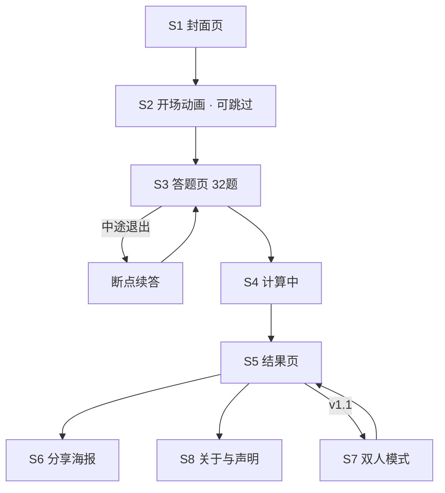

# 六、页面与交互设计 v2

## 6.1 设计概念：「高原列车 · 丹霞票根」

> **把测试结果做成一张票根：从"走散"开往"重逢"或"告别"的高原列车，18 天，一段关系，一张票。**

三个视觉母题（v2 沿用）：

| 母题 | 来源 | 用法 |
|---|---|---|
| **丹霞层理** | 张掖丹霞的红—橙—金渐变 | 背景渐变、进度条、海报底色 |
| **列车票根** | 18 天高原列车、车票、行李牌 | 结果主卡、分享海报、题卡造型 |
| **检票章** | 站台、检票、出发与到达 | 结果卡上的"已检票"章、日期、车次号 |

情绪曲线：**期待（封面）→ 代入（开场动画）→ 沉浸（答题）→ 悬念（计算）→ 仪式感（结果）→ 表达欲（分享）**。

## 6.2 信息架构与主流程



## 6.3 逐屏设计

### S1 封面页

| 区域 | 内容 |
|---|---|
| 顶部 | 小字：「非官方粉丝向二创 · 仅供娱乐」（必须可见，不遮挡） |
| 主标题 | **后会友期 · 人格拼图** |
| 副标题/hook | 「你和 TA 走散的第几年？」 |
| 主视觉 | 8 张人物票根呈扇形叠放（原创剪影 + 名字 + 功能标签），轻微漂浮动画 |
| 核心信息 | 32 题 · 约 5 分钟 · 8 位旧友 × 每人 3 个节目时刻 · **24 种人格拼图** |
| CTA | 主按钮：**领取我的车票** |
| 社会证明 | 「已有 12,847 人上车」（真实数据；不足时显示"今天已有 xxx 人"） |
| 底部 | 关于 · 免责声明 · 数据说明 |

**埋点**：`view_home`、`click_start`。

### S2 开场动画（v2 新增，可跳过）

**目标**：在答题前完成"心理代入"——用户先把 TA 想成那个走散的人，再上车。

- 形式：全屏深色车厢/夜空背景，文字逐句浮现（约 1.7 秒一句，总长约 10–12 秒）；
- 右上角常驻「跳过」；点击任意位置可加速；`prefers-reduced-motion` 时直接静态展示全部文字 + 3 秒后进入；
- 文案（6 句）：

> 2026 年，你收到一张没有署名的车票。
> 终点是张掖。同行的是四组走散多年的旧友。
> 还有一个人——你也说不清，还算不算朋友。
> 接下来 18 天，你不需要和好，只需要诚实。
> 现在，请把 TA 想成那个你一直没联系的人。
> 检票上车。

- 结尾自动进入第 1 题；底部小字：「凭第一反应作答 · 没有标准答案」。
- 可选（v1.1）：允许输入 TA 的昵称，题目中替换"TA"（仅本地保存，不上传）。

**埋点**：`view_intro`、`skip_intro`、`intro_complete`。

### S3 答题页

**布局**

```
┌──────────────────────────────┐
│ 第 12 / 32 题   第 7 天·旅途摩擦 │  ← 顶栏（固定）
│ 第1天──第3天──第7天──第12天──第18天 │  ← 列车进度条（5 站）
│ 「再好的旧友，也会在第七天互相看不顺。」│  ← 部分引导语
├──────────────────────────────┤
│  为去不去一个景点，             │
│  你和 TA 分成两派，你——         │  ← 题干
│  ┌────────────────────────┐  │
│  │ A  先上车再说，到了再定  │  │  ← 座位卡
│  ├────────────────────────┤  │
│  │ B  有一种"这趟要出事"的预感│ │
│  ├────────────────────────┤  │
│  │ C  把时间预算摊开，当场算清│ │
│  ├────────────────────────┤  │
│  │ D  不想去就不去，不勉强自己│ │
│  └────────────────────────┘  │
├──────────────────────────────┤
│ [← 上一题]            [退出]  │
└──────────────────────────────┘
```

**交互细节**

| 行为 | 反馈 |
|---|---|
| 点击选项 | 高亮 + 轻微下沉（80ms）→ 200ms 后进入下一题 |
| 回退 | 保留已选答案 |
| 断点续答 | localStorage + 每 3 题同步服务端；重新进入弹「继续上次的车票」 |
| 键盘 | A/B/C/D 选择，← 回退，Enter 确认 |
| 退出 | 二次确认 + 进度保存 |
| 选项乱序 | 每个 session 固定 seed，同一用户顺序一致 |

**进度条**：5 个站点（第1天/第3天/第7天/第12天/第18天），与 5 个题部分一一对应；站点名来自题库 `meta.parts`，切换部分时显示一句引导语（约 14–18 字）。

### S4 计算中

- 2.5–3.5 秒；全屏丹霞车窗动画；
- 文案轮播：正在回放你们那 18 天…… / 在观察室里，给每一种动机打分…… / 把你的选择和 8 位旧友对上号……；
- 失败可重试；重复提交幂等。

### S5 结果页（v2 新顺序）

> 顺序严格按：**人格拼图（含台词）→ 判词 → 人物关系 → 本我位/关系位/社会位 → 数据卡 → 结局预测 & 一句话**。

1. **人格拼图卡（票根）**
   - 顶部：车次号 `HHYQ-XF-1` + 「后会友期 · 人格拼图」
   - 组合名大字：**许飞「悬崖小屋版」**（人物 + 后置定语）
   - 台词区：「你对我的所有指控，我也都收到了，无论那些罪名是否属实，我想你当时一定都非常心碎。」
   - 台词出处：`—— 许飞 · 悬崖小屋对谈后段 · 节目原话`（原话/转述/书面/节目外必须标注）
   - 底部只保留检票章与装饰条形码（v2.2 已去掉"姿态/底色/检票"那行，姿态与底色在判词/中段模块里）
   - 底部：姿态（想修复/还没想好/想告别）· 底色（ESTP）· 检票日期
   - 检票章 + 装饰条形码
2. **判词**：解释"为什么是你 + 这句话"（人物 → 姿态 → 台词），末尾带完整底色
3. **人物关系**：最容易和谁走散 / 最想依赖的人（来自完整功能栈）
4. **本我位**：人物 + 主导功能 + 底色
5. **关系位**：关系姿态 + 关系身份 + 修复指数 + 辅助功能
6. **社会位**：九型动机 + 行动风格 + 礼物/雷区
7. **数据卡**：八维雷达、九型条形、行动风格、修复指数条
8. **结局预测 & 一句话**：按姿态给结局文案 + 可复制"给旧友的一句话"
9. **行动区**：保存车票海报 / 分享 / 复制结果 / 再测一次 /（v1.1）邀请 TA 一起测
10. **底部**：免责声明 + 关于 + 反馈

**埋点**：`view_result`、`click_quote`、`view_module`、`view_radar`、`click_share`、`share_success`。

### S6 分享海报

| 模板 | 尺寸 | 内容 |
|---|---|---|
| **票根版**（默认） | 1080 × 1920 | 丹霞底 + 组合名 + 台词（带出处）+ 一句判词 + 二维码 |
| **金句版** | 1080 × 1080 | 大字台词 + 组合名 + 小字出处 + 二维码 |

海报必须含：节目名 + 「非官方二创」小字 + 二维码（带 UTM 追踪）。

### S7 双人模式（v1.1）

- 入口：结果页「邀请 TA 一起测」/ 首页「输入 TA 的结果码」。
- 报告：合拍度、你们像哪一对旧友、18 天旅程预测、谁先转身、给 TA 的一句话。
- 隐私：只展示组合与维度倾向，不展示作答明细；双方同意才生成。

### S8 关于与声明

产品说明、数据说明（匿名、不采集敏感信息）、免责声明全文、反馈入口、更新日志。

## 6.4 交互与动效规范

| 场景 | 时长 | 缓动 | 降级 |
|---|---|---|---|
| 开场文字浮现 | 700ms/句，间隔 1.7s | ease-out | 静态展示 |
| 选项点击 → 下一题 | 200ms | `cubic-bezier(.22,.61,.36,1)` | 淡入 |
| 进度列车移动 | 350ms | ease-out | 直接跳位 |
| 票根入场 | 600ms | 上浮 + 轻微旋转 | 淡入 |
| 检票章落下 | 350ms | scale 1.4→1 + 回弹 | 直接显示 |
| 雷达图生长 | 800ms | ease-out | 直接显示 |
| 数字滚动 | 600ms | ease-out | 直接显示 |

支持 `prefers-reduced-motion`；点击区域 ≥ 44×44px；弱网骨架屏；桌面端最大宽度 560px 居中。

## 6.5 文案清单

| 位置 | 文案 |
|---|---|
| 页面 title | 后会友期 · 人格拼图｜测出你的后友期人格拼图 |
| 封面主标题 | 后会友期 · 人格拼图 |
| 封面 hook（A/B） | 「你和 TA 走散的第几年？」/「如果重来一次，你还会和 TA 上车吗？」 |
| CTA | 领取我的车票 |
| 开场文案 | 见 S2 六句 |
| 引导弹层（可并入开场） | 凭第一反应选，没有对错。32 题，约 5 分钟。 |
| 计算文案 | 正在回放你们那 18 天…… / 在观察室里，给每一种动机打分…… / 把你的选择和 8 位旧友对上号…… |
| 结果页分享语 | 「我的后友期人格拼图是：许飞「悬崖小屋版」。你呢？」 |
| 海报落款 | 后会友期 · 人格拼图（非官方二创 · 仅供娱乐） |
| 免责声明 | 本测试为《后会友期》非官方二创，仅供娱乐。人物解读为节目语境下的创意演绎，不代表对真实人物的评价，也不代表节目组立场。本测试不构成任何心理学诊断。节目名称与人物姓名相关权利归原权利人所有。 |

## 6.6 视觉规范（Design Tokens）

| Token | 色值 | 用途 |
|---|---|---|
| `--ink` | `#1C2438` | 主文字、票根边框（夜空墨蓝） |
| `--paper` | `#F6F0E4` | 页面底色（旧纸米白） |
| `--rust` | `#B84B32` | 主色：丹霞赭红（按钮、重点、印章） |
| `--amber` | `#E3A63C` | 辅色：戈壁金（进度、台词底） |
| `--sky` | `#3C6E8F` | 点缀：高原蓝（链接、雷达线） |
| `--moss` | `#2F7D6D` | 语义：修复 |
| `--slate` | `#6B7A8F` | 语义：告别 |
| `--dust` | `#C9BCA6` | 次级文字、分割线 |

- 字体：标题思源宋体 Heavy / 正文思源黑体 / 数字 DIN；组合名 24–30px；
- 人物表现：只用原创剪影/几何头像 + 文字姓名，不用节目海报、剧照、肖像；
- 票根：圆角 4px、左侧打孔虚线、上下锯齿边、做旧印章；
- 布局：8pt 栅格，左右边距 20px，内容最大宽度 560px；结果页长滚动。

## 6.7 可用性与无障碍

- 正文对比度 ≥ 4.5:1；
- 支持系统字号放大（rem 布局）；
- 键盘可完成全流程（A–D / ← / Enter）；
- 动效可关闭（`prefers-reduced-motion`）；
- 不依赖颜色单独传达信息（修复/告别同时有文字与图标）。

## 6.8 分享与裂变设计

| 钩子 | 说明 | 阶段 |
|---|---|---|
| 组合名自带梗 | 「悬崖小屋版」「露天烧烤版」天然适合截图/发朋友圈 | v2 |
| 台词卡 | 名字下面就是本人金句，评论区容易对暗号 | v2 |
| 票根海报 | 不像测试结果，像一张真的车票 | v2 |
| 「你最容易和谁走散」 | @ 那个人的天然理由 | v2 |
| 双人模式 | 「拉 TA 测一下，看你们像哪一对旧友」 | v1.1 |
| 观察室彩蛋 | 你的答案对应哪位观察室嘉宾的视角 | v1.2 |

## 6.9 原型说明

`prototype/index.html` 是可点击的高保真交互原型（单页、无需构建）：

- 封面 → **开场动画（可跳过）** → 完整 32 题（v2 题面，权重未变）→ 结果页；
- 结果页实现：票根人格拼图（名字 + 台词 + 来源标注）、判词、人物关系、本我/关系/社会位、八维雷达、九型条形、关系行动、结局预测与一句话；
- 支持回退、进度、结果码、复制结果；
- 视觉为"设计验证版"，最终视觉以设计稿为准。
