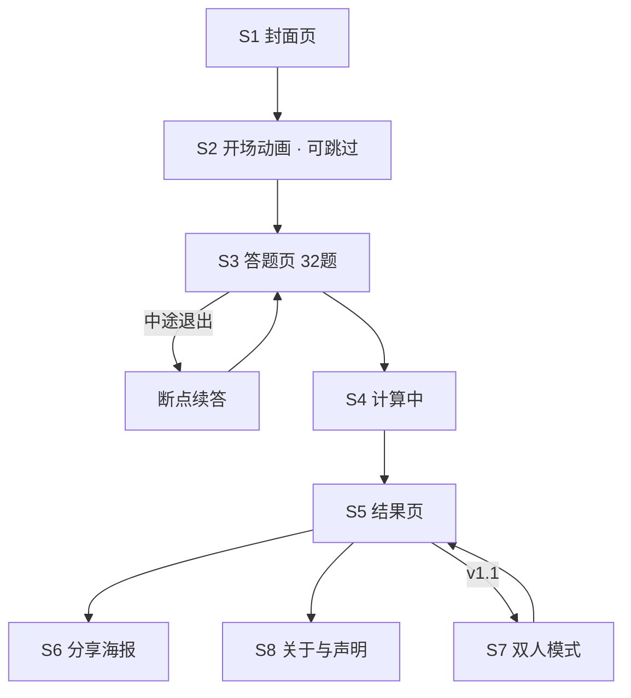

# 《后会友期 · 人格拼图》网页趣味测试 · 设计方案 v2.0

> **一句话**：基于芒果TV综艺《后会友期》8 位旅程嘉宾的三层人格拼图测试——32 道题、约 5 分钟，生成一个**唯一组合**：
> **许飞「悬崖小屋版」**、**王子璇「露天烧烤版」**、**白小纯「道歉现场版」**……

| 项目 | 内容 |
|---|---|
| 文档版本 | v2.0（2026-11-14，替代 v1.0） |
| 产品形态 | 移动端优先的网页 H5（微信内可玩），非官方粉丝向二创 |
| 结果格式 | **人物 + 后置定语**：`{人物}「{节目时间事件版本}」` |
| 组合空间 | **24 个唯一组合** = 8 位人物 × 每位人物单独设计的 3 个版本 |
| 每个组合 | 组合名 + 该人物本人一句台词（标注 原话/转述/书面/节目外）+ 关系姿态 |
| 单局时长 | 32 题，约 5 分钟；可断点续答 |
| 开场 | 新增 8–12 秒可跳过的"代入式"文字动画 |
| 工期估算 | MVP 5 个工作日（v2 方案已就绪） |
| 配套文件 | `spec/`（内容 + 版本库 + 计分引擎 + 校验）、`prototype/`（可玩原型 v2）、`research/`（节目资料 + 金句库存 + v2 题库） |

---

## 摘要

《后会友期》是芒果TV 2026 年 10 月 22 日上线的友情纪实综艺：四对走散的旧友，用 18 天高原列车旅行重新面对彼此，**不强制和解、允许体面告别**。节目上线后成为现象级综艺（云合市占率一度 92%+、豆瓣开分 8.7、正片播放破 6 亿），"我画地为牢啊，厉娜""被子没了""亚军天团"等名场面自带传播力。

v2 把测试结果从"5 段式长组合"重做成**一句话就能记住的"人格拼图"**：

> **许飞「悬崖小屋版」** —— 下方配一句许飞本人在那场对谈里说过的话：「你对我的所有指控，我也都收到了……我想你当时一定都非常心碎。」

- **三层隐射不变**：荣格八维决定"你像谁"（8 位人物一人一格），MBTI 式四维决定"你的底色"（16 型），九型人格决定"你为什么"（9 型）；再加节目专属的"关系行动"层。
- **v2 新增版本层**：同一个人物会有 **3 个专属的「节目时间事件版本」**（如许飞：悬崖小屋版 / 画地为牢版 / 布达拉宫版），由你的**关系姿态**（想修复 / 还没想好 / 想告别）决定你落到哪一个。**每人单独设计，不是通用三后缀；每个后缀都必须是节目里的具体事件或场景。**
- **台词跟着组合走**：每个版本配一句该人物本人说过（或写下）的话，并标注原话 / 转述 / 书面 / 节目外，避免"假台词"。
- **结果页重排**：人格拼图（含台词）→ 判词 → 人物关系 → 本我/关系/社会位 → 数据卡 → 结局预测 & 一句话。
- **开场动画**：开始答题前，用 6 句可跳过的文字让用户先想起那个走散的人，再上车。

方案的差异点：**不是又一个 MBTI 换皮测试**，而是把三套理论"藏"进节目人物的关系叙事里——用户拿到的不只是四个字母，而是一个有梗、有台词、能截图、能 @ 好友的名字。

---

## 本次迭代（v2 相对 v1 的变更）

| # | 变更 | 说明 |
|---|---|---|
| 1 | **组合名精简** | 从 `{主人物}{特质A}{副人物}{特质B}{身份}`（1,152 种）→ `{人物}「{版本后缀}」`（24 种） |
| 2 | **新增版本层** | 8 位人物 × 每人单独设计的 3 个「节目时间事件版本」；版本由关系姿态（修复/摇摆/告别）决定 |
| 3 | **新增台词** | 每个组合配一句该人物本人台词；标注来源类型；同人物不同版本配不同台词 |
| 4 | **结果页重排** | 人格拼图（含台词）→ 判词 → 人物关系 → 本我/关系/社会位 → 数据卡 → 结局 & 一句话 |
| 5 | **新增开场动画** | 8–12 秒、可跳过，内容是"先想起那个走散的人，再上车" |
| 6 | **32 题题面改写** | 全部改成"你和 TA 同乘 18 天"的叙事；**权重逐字节未变**，配平与唯一性校验仍全部通过 |
| 7 | **模块重做** | 本我位=人物+主导功能；关系位=姿态+关系身份；社会位=九型+行动风格 |
| 8 | **文案校正** | 修正 v1 文吉儿台词误挂（"不同阶段有不同认知"实为陆翊所说）；所有台词重新核实 |

---

## 文档结构

| 章节 | 内容 | 适合谁读 |
|---|---|---|
| 一、项目概述 | 定位、目标用户、玩法闭环、成功指标 | 所有人（3 分钟） |
| 二、为什么是这个选题 | IP 热度、传播窗口、竞品问题、我们的解法 | 产品 / 运营 |
| 三、理论底层 | 八维 → 8 人物、MBTI 式 16 型、九型、关系行动、**版本层** | 内容 / 算法 |
| 四、唯一组合系统（核心） | 组合语法、24 版本表、生成算法、唯一性证明、台词规则 | 产品 / 算法 / 开发 |
| 五、题目与计分 | 32 题结构、计分模型、v2 题面改写、配平校验、模拟分布 | 内容 / 开发 |
| 六、页面与交互设计 | 流程图、封面、**开场动画**、答题、结果页新顺序、视觉规范 | 设计 / 前端 |
| 七、结果内容体系 | 24 版本与台词全表、人物卡、判词模板、示例结果全文 | 内容 / 运营 |
| 八、技术方案 | 架构、API、数据模型、分享卡、埋点、部署、测试 | 开发 |
| 九、合规、排期与迭代 | 风险清单、5 天排期、路线图、成功指标 | 所有人 |
| 附录 | 32 题全表、24 组合索引与校验报告、参考来源 | 开发 / 审核 |

> 建议阅读顺序：**摘要 → 四、唯一组合系统 → 六、6.3 结果页 → 七、7.2 版本与台词表**。

---

## 配套文件

| 文件 | 说明 |
|---|---|
| `docs/设计方案.md` | 本文档（v2 完整方案） |
| `spec/characters.json` | 8 位人物卡数据（功能、金句、关系位、文案） |
| `spec/versions.json` | **v2 版本库**：24 个「人物 × 时间事件版本」，含台词、来源类型、姿态、场景 |
| `spec/mbti-types.json` | 16 型 × 主/副人物映射 |
| `spec/enneagram.json` | 九型人格 × 形容词 × 三元组 |
| `spec/identities.json` | 8 种关系身份 |
| `spec/questions.json` | 32 题题库（v2 题面、权重未变，含隐藏权重，服务端资产） |
| `spec/scoring.mjs` | 计分引擎 v2（人物 + 版本 + 台词 + 完整底色） |
| `spec/combinations.json` | 24 个组合全量索引 |
| `spec/validate.mjs` / `spec/persona-test.mjs` | 唯一性、版本覆盖、配平、分布、人设可达性校验 |
| `spec/validation-report.txt` | 最近一次校验输出（可直接作为验收证据） |
| `prototype/index.html` | 可点击的交互原型 v2（开场动画 + 完整 32 题 + 票根结果页） |
| `research/characters.md` | 节目与 8 位嘉宾的公开资料研究（含来源与未证实清单） |
| `research/quotes-v2.md` / `.json` | 8 人 × 3 主选 + 2 备选的金句库存（含来源与安全备注） |
| `research/questions-v2.json` / `.md` | v2 题库与改写说明（权重未改的核对记录） |

复跑校验：

```bash
node spec/validate.mjs        # 24 组合唯一性 / 版本覆盖 / 配平 / 分布
node spec/persona-test.mjs    # 24 组合可达性
node scripts/build-docs.mjs   # 重新生成本文档
```

---

# 一、项目概述

## 1.1 一句话介绍

> **32 道关于"走散的友情"的选择题，换一张只属于你的《后会友期》人格车票。**

体验路径：

1. 用户点开 H5 →「领取我的车票」
2. 先看 8–12 秒**可跳过的开场动画**：把 TA 想成那个走散的人，再上车
3. 用 5 分钟回答 32 道情境题（第 1/3/7/12/18 天：检票、重逢、摩擦、夜聊、告别）
4. 后台按三套人格理论 + 节目专属关系维度打分，再落到"人物 × 节目时间事件版本"
5. 得到唯一组合（例：**许飞「悬崖小屋版」**）+ 该人物一句台词 + 一张票根海报
6. 分享 / @ 旧友 / 拉对方一起测（v1.1 双人报告）

## 1.2 产品定位

| 维度 | 定义 |
|---|---|
| 品类 | 综艺二创的移动端趣味人格测试（H5，微信内可玩） |
| 调性 | 温柔、克制、有一点好笑；不贩卖焦虑，不做"你注定没朋友"的宿命论 |
| 与节目的关系 | 非官方粉丝向二创；人物解读为"节目语境下的创意演绎"，不是对真实人物的评价 |
| 目标 | 让节目观众"测自己、晒结果、@ 旧友"，二次传播节目情绪 |
| 非目标 | 不是心理测评、不做诊断、不卖报告、不采集敏感个人信息 |

## 1.3 目标用户

| 人群 | 画像 | 为什么会被吸引 |
|---|---|---|
| 节目观众 | 18–35 岁，追《后会友期》正片与观察室，对四组旧友有立场 | 想知道"我在这个故事里是谁"、想站队、想讨论 |
| 泛人格测试用户 | 测过 MBTI / 九型 / 各种小测试，喜欢截图分享 | 想拿到"不一样"的结果：不是四个字母，而是一个有梗的组合名 |
| 社交传播人群 | 有"走散的旧友"、想找由头重新联系 | 双人模式提供"体面联系"的社交借口 |
| 内容创作者 | 小红书/抖音的测试类、综艺类博主 | 结果名与票根视觉天然适合二创 |

## 1.4 核心玩法循环

```mermaid
flowchart LR
  A[刷到分享/朋友@] --> B[封面页 · 领取车票]
  B --> I[开场动画 · 可跳过]
  I --> C[32题 · 约5分钟]
  C --> D[计算中 · 列车穿越丹霞]
  D --> E[结果页 · 人格拼图 + 台词 + 票根]
  E --> F[保存海报 / 分享]
  E --> G[双人模式 v1.1 · 输入好友码]
  F --> A
  G --> H[生成关系报告 · 邀请对方测]
  H --> C
```

增长飞轮：**结果名有梗 → 截图分享 → 朋友好奇 → 新用户进入**；双人模式把"分享"升级成"必须拉一个人来"。

## 1.5 差异化

| 常见做法 | 本方案 |
|---|---|
| 只给 MBTI 四字母 + 一段通用解读 | 三层拼图：八维（像谁）× MBTI（底色）× 九型（动机）+ 关系行动（结局）+ **节目时间事件版本** |
| 结果同质化，朋友圈撞车 | **24 个唯一组合**（8 人 × 每人 3 个专属节目时刻），名字短、有梗、可截图 |
| 与节目只有"贴图"关系 | 人物映射、版本名、台词、题目场景、结局预测全部长在节目叙事上 |
| 分享海报是"结果截图" | 结果页就是一张**高原列车票根**：名字 + 本人台词 + 姿态 + 检票章 |
| 测完即走 | 双人模式 / "你最容易和谁走散" / 观察室彩蛋（v1.1）提供二次传播钩子 |

## 1.6 成功指标

| 层级 | 指标 | 目标（上线 2 周） |
|---|---|---|
| 北极星 | 完成测试并产生分享的人数 | ≥ 10 万 |
| 漏斗 | 首页 → 开始测试转化率 | ≥ 55% |
| 漏斗 | 开始 → 完成 32 题转化率 | ≥ 65% |
| 传播 | 结果页分享率（点击分享 / 完成测试） | ≥ 18% |
| 传播 | 分享带来的新用户占比（K 因子） | ≥ 0.35 |
| 体验 | 中位完成时长 | ≤ 5 分 30 秒 |
| 内容 | 重测率（7 日内） | ≥ 8% |
| 质量 | 结果页报错率 / 白屏率 | < 0.5% |
| 合规 | 侵权/名誉相关投诉 | 0 起（预案见第九章） |

## 1.7 交付物清单

| 阶段 | 交付物 | 状态 |
|---|---|---|
| 方案 | 本文档 v2 | ✅ 已完成 |
| 内容 | `spec/` 下全部 JSON（人物 / 版本库 / 类型 / 九型 / 身份 / 题库） | ✅ 已完成 |
| 算法 | `spec/scoring.mjs` 计分引擎 v2 + 校验脚本 | ✅ 已完成并通过校验 |
| 原型 | `prototype/index.html` 可玩原型 v2（开场动画 + 32 题 + 票根人格拼图） | ✅ 已完成 |
| 研究 | `research/characters.md`（节目与 8 人公开资料、来源、合规提醒） | ✅ 已完成 |
| 台词 | `research/quotes-v2.md`（8 人 × 3 主选 + 2 备选，含来源与安全备注） | ✅ 已完成 |
| 题库 | `research/questions-v2.json`（32 题 v2 题面，权重未改） | ✅ 已完成 |
| 待办 | 视觉设计稿、分享海报模板、双人模式（v1.1）、正片字幕校准 | ⏳ 开发阶段 |

---

# 二、为什么是这个选题

## 2.1 IP 热度：一个正在窗口期的现象级综艺

《后会友期》2026-10-22 上线，四对走散的旧友用 18 天高原列车旅行重新面对彼此。可核实的公开数据（来源见附录 C）：

| 指标 | 数值 | 说明 |
|---|---|---|
| 云合·上线首日正片有效播放市占率 | **34.9%**，空降热播新综霸屏榜 TOP1 | 起步即爆 |
| 云合·11 月 5 日（第四期） | 新综赛道 **92%+**（口径 92%/92.5%/92.7%），断层第一 | 现象级集中度 |
| 豆瓣 | 开分 **8.7** | 口碑支撑 |
| 正片累计播放 | 媒体口径 **破 6 亿** | 未逐平台实时核验 |
| 话题 | 24 小时 **157 个热搜**、56 个进 TOP10；11/5 芒果TV 服务器因流量崩溃 | 社交讨论密度极高 |
| 资本端 | 芒果超媒 10/30–11/10 **+59.42%**，市值 417 亿 → 665 亿（+200 亿） | 出圈佐证 |
| 排播 | 全季 **12 期**，按双更节奏播至 **12 月底** | 传播窗口约 6 周 |

**结论**：现在做这个 IP 的二创测试，正处于"讨论度最高、内容池最厚、用户最愿意晒"的窗口期；12 月底收官前是最佳上线时间。

## 2.2 为什么这个节目特别适合做人格测试

1. **四组矛盾就是四种"关系原型"**：告密罗生门（信任/辩白）、邀戏误会（沟通/面子）、序言排位（位置/独占）、训练态度（标准/传话）——天然对应"你在关系里会怎么处理"。
2. **节目给了第三层维度**：一般人格测试只能回答"你是谁"，而《后会友期》的核心命题是"**走散的关系要不要修复**"。这让我们可以设计别人没有的槽位——关系身份与关系姿态；v2 再把它落成"**人物 × 3 个节目时间事件版本**"：同一个人物，你处在想修复/还没想好/想告别的不同姿态，就会落到 TA 不同的名场面与台词。
3. **人物辨识度极高**：8 位嘉宾的行为逻辑清晰、金句密布（"我画地为牢啊，厉娜""人类好可怕，我要回郊区了""承认了，这就已经够了"），适合做"人格位"。
4. **观众有强烈的表达欲**：站队、共情、复盘、玩梗——他们需要一个"可截图、可 @ 人"的载体。
5. **节目价值观与产品一致**："不强制和解、允许体面告别"——所以结果不做"教你挽回"，而是"你是哪一种走散方式"，减少说教感，也更安全。

## 2.3 常见人格测试产品的三个问题

| 问题 | 表现 | 后果 |
|---|---|---|
| **结果同质化** | 全站只有 16 型 × 几段文案，朋友圈一刷全是 INTJ | 缺乏"晒"的动力，用户觉得"跟别人一样" |
| **和 IP 只有贴图关系** | 题目是通用题库，把结果换成综艺角色名 | 用户一眼看穿"换皮"，不认可、不传播 |
| **只有一层解读** | 只给 MBTI 或只给九型 | 解释力弱："我为什么会这样"回答不了 |

## 2.4 我们的解法

| 问题 | 本方案 |
|---|---|
| 结果同质化 | **三层 × 版本层** → 24 个唯一组合（8 位人物 × 每人 3 个节目时间事件）；名字短、有梗，晒出来不撞车 |
| IP 换皮 | 人物 = 八维功能化身；题目场景全部来自节目；第三层"关系行动"是节目专属 |
| 解释力弱 | 三层各回答一个问题：你是谁（MBTI 底色）、你为什么（九型动机）、你会怎么收场（关系身份） |
| 缺传播点 | 票根视觉 + 组合名有梗 + 双人模式 + "最容易和谁走散" |
| 不安全 | 非官方声明、不评价真人、传闻零容忍、不做宿命论结论（详见第九章） |

## 2.5 传播窗口与可迁移性

- **时间窗**：节目 12 月底收官，最佳上线窗口 11 月下旬—12 月上旬；建议预留 2 周迭代。
- **可迁移**：本方案的三层结构（八维 → 人物 / MBTI / 九型 / 关系行动）与人物库解耦，换成第二季、换一档"关系类"综艺，只需替换 `spec/characters.json` 与题库场景，引擎与页面可复用。
- **长尾**：24 个组合可生成 24 个结果落地页（`/r/{code}`），天然适合长尾搜索与二次传播（SEO/收录策略另见技术章节）。

## 2.6 参考数据来源

- 360娱乐《〈后会友期〉开播，4对旧友冲突引热议！观察室爆料比正片还猛》 https://yule.360.com/detail/5292944
- 江南都市报（新浪财经转载）《芒果TV推出友情纪实综艺〈后会友期〉…嘉宾阵容官宣》 https://finance.sina.cn/2026-10-16/detail-inivmiif7666303.d.html
- 环球时报（网易转载）《大陆综艺〈后会友期〉靠友情在岛内引共鸣》 https://www.163.com/dy/article/LBJJUD8U0514R9OJ.html
- 华夏时报《一句话点燃〈后会友期〉，芒果超媒市值增200亿元》 https://www.chinatimes.net.cn/article/156948.html
- 半岛都市报《半岛观察丨走散的友情为何成了大众情绪的出口？》 https://www.sohu.com/a/1101252917_355158

> 完整来源与"未核实清单"见 `research/characters.md` D 节。

---

# 三、理论底层：三套体系如何"隐射"到 8 位人物

> 一句话版本：**八维决定你像谁，MBTI 决定你的底色，九型决定你为什么，关系行动决定你会怎么收场，版本层决定你停在 TA 的哪个名场面。**

## 3.1 荣格八维 → 8 位人物（人格位层）

设计原则：**一人一格**。8 位旅程嘉宾各自对应荣格八维中的一个功能，成为测试里的"人格位"。这样任何一个结果都天然是"两个人物的拼贴"，既有梗、又有辨识度，也满足"组合必须包含后会友期人物"这一要求。

| 功能 | 中文 | 一句话定义 | 人物 | 人物关键词 | 映射理由（节目语境） |
|---|---|---|---|---|---|
| Se 外倾感觉 | 活在当下 | 感官与行动优先，反应快，先做再说 | **白小纯** | 少年感、直给、现场派 | 电竞选手；情绪来得快散得快，"我现在不想和好"说完也就过去了；拒绝"鞠躬＋拥抱"的标准和解剧本 |
| Si 内倾感觉 | 记忆账本 | 把经历存档，用过去的经验校准现在 | **厉娜** | 旧账、要说法、秩序 | 记得二十年前阳台上的 T 恤、十进八那一票、三封律师函和七年空白；她要的是一个"交代" |
| Ne 外倾直觉 | 可能性发散 | 点子、联想、多线程，注意力向外发散 | **青稚** | 多线程、没边界感、想聊开 | 不直接沟通先找管理层、话题跳得快、"除了游戏现实中我和他挺处得来"——他的失误是忽略了对方的单一痛点 |
| Ni 内倾直觉 | 终局判断 | 透过表面看走向，落点是意义 | **马天宇** | 独处、整体判断、低欲望 | 从一次"删微信"直接跳到"人类好可怕"的整体判断；谈到"没有幸福感""虚无"，习惯给关系找底层动机 |
| Te 外倾思维 | 推进执行 | 目标、流程、可核查，把事办成 | **文吉儿** | 存档、对账、规则 | 保存八年的转账记录与聊天截图，上节目当众对质；把关系处理成"留证—对账—结论"的流程 |
| Ti 内倾思维 | 原理自洽 | 先内部算清楚，再决定要不要说 | **许飞** | 冷处理、不解释、心里有账 | 面对旧事用"记不清了"隔离情绪，只认"罪名是否属实"；那句笨拙的"我想你一定非常心碎"，像 Ti 的人难得调用的情感功能 |
| Fe 外倾情感 | 关系雷达 | 对关系位置、气氛、他人情绪高度敏感 | **张萌** | 关系修复、推进、直给 | 主动邀约马天宇上节目；看到他崩溃时轻声说"也许我不应该叫他来这里"；她的判断标准是"关系有没有恢复和谐" |
| Fi 内倾情感 | 内在真实 | 用"真不真"判断一切，边界感强 | **王子璇** | 真实、体面、分账 | "我收费用是真的，虚荣心是真的……但拼凑出来表述的那个人，不是真的我。"——宁可当场退钱断交，也不接受被定义 |

> ⚠️ 说明：以上是**节目语境下的创意演绎**，不是对真实人物的心理学测评，也不代表节目立场。人物资料与金句均来自公开报道（见附录参考来源）。

**为什么这版映射值得信任**：映射不是按"谁看起来像什么"硬贴，而是先按节目中可观察的**行为证据**（冲突处理、决策方式、情绪表达、关系观）定功能，再做两处工程约束校正：

1. 8 个功能必须一人一格、不重不漏；
2. 让用户给出的示例 `白小纯 + 许飞` 恰好构成一个合法的 MBTI 功能栈（Se 主导 + Ti 辅助 = ESTP），示例才能 100% 可产出。

## 3.2 MBTI 式四维 → 16 型底色

**规则**：主导功能 + 辅助功能唯一确定 16 型中的一型。因此：

- **主人物 = 主导功能的化身**
- **副人物 = 辅助功能的化身**
- 二者合起来 ↔ 一个 MBTI 式四字母类型（16 型一一对应）

> v2 说明：**主人物/副人物只作为"完整底色"在中段展示；组合名只保留主人物**（即"你像谁"），副人物不再进入名字。16 型、九型、关系身份仍全量计算，见第五章。

| 类型 | 车次昵称 | 主导 | 辅助 | 主人物 | 副人物 | 一句话 |
|---|---|---|---|---|---|---|
| ESTP | 说走就走的人 | Se | Ti | 白小纯 | 许飞 | 先冲，再想；想清楚了，也不回头。 |
| ESFP | 车厢气氛灯 | Se | Fi | 白小纯 | 王子璇 | 把快乐给出去，把账算清楚。 |
| ISTP | 随身工具箱 | Ti | Se | 许飞 | 白小纯 | 话不多，动手最快。 |
| INTP | 十万个为什么 | Ti | Ne | 许飞 | 青稚 | 在心里演算一百遍，才说一句话。 |
| ENTP | 提案永动机 | Ne | Ti | 青稚 | 许飞 | 点子先飞出去，逻辑随后跟上。 |
| ENFP | 自来熟小太阳 | Ne | Fi | 青稚 | 王子璇 | 热爱所有人，也需要一个角落。 |
| INFP | 安静的理想国 | Fi | Ne | 王子璇 | 青稚 | 心里有一个不肯妥协的世界。 |
| ISFP | 温柔的独行侠 | Fi | Se | 王子璇 | 白小纯 | 柔软，但有自己的速度。 |
| ESTJ | 行程表本人 | Te | Si | 文吉儿 | 厉娜 | 把混乱排成表，把问题推进到解决。 |
| ENTJ | 列车长 | Te | Ni | 文吉儿 | 马天宇 | 目标是终点，感情是风景。 |
| ISTJ | 时刻表信徒 | Si | Te | 厉娜 | 文吉儿 | 承诺过的事，会按时到站。 |
| ISFJ | 随身带药的人 | Si | Fe | 厉娜 | 张萌 | 记得所有人的忌口，唯独不说自己累。 |
| ESFJ | 气氛组组长 | Fe | Si | 张萌 | 厉娜 | 场子不能冷，谁都不能被落下。 |
| ENFJ | 关系粘合剂 | Fe | Ni | 张萌 | 马天宇 | 能看见每个人的需要，也能看穿沉默。 |
| INTJ | 终局下棋人 | Ni | Te | 马天宇 | 文吉儿 | 想三步之后的事，忍住此刻的话。 |
| INFJ | 看透不说的人 | Ni | Fe | 马天宇 | 张萌 | 把善意藏进沉默里。 |

> 彩蛋：ENFJ（张萌 × 马天宇）与 INFJ（马天宇 × 张萌）恰好对应节目里真实的那对旧友——组合系统没有刻意凑 CP，但偶合出来很有梗。

**四字母从哪里来（让用户看得懂）**：

- E / I：主导功能的朝向（外倾 / 内倾）
- S / N：功能栈中的感知功能（感觉 / 直觉）
- T / F：功能栈中的判断功能（思维 / 情感）
- J / P：外倾的那个功能是判断功能（J）还是感知功能（P）

> 为什么不用"四道独立轴题"直接问外向内向？因为**功能栈比自陈标签稳定**，也避免用户"选一个听起来更好的人设"。四字母仍然会作为结果展示，但它是推导出来的，不是问出来的。

## 3.3 九型人格 → 动机层

九型负责回答"**你为什么这么做**"。9 个主型各配一个"形容词"，同时按三元组归成 3 个"情感基调"：

| 九型 | 名称 | 主型形容词（中段展示） | 三元组 | 三元组形容词（中段展示） | 核心动机 |
|---|---|---|---|---|---|
| e1 | 完美型 | 较真的 | 腹中心 | 笃定的 | 想把事做对，也把自己管好 |
| e2 | 助人型 | 爱操心的 | 心中心 | 感性的 | 被需要才安心 |
| e3 | 成就型 | 做事的 | 心中心 | 感性的 | 做成事才配被喜欢 |
| e4 | 自我型 | 独特的 | 心中心 | 感性的 | 想被看见"真实的我" |
| e5 | 理智型 | 旁观的 | 脑中心 | 清醒的 | 先看懂世界，再决定靠不靠近 |
| e6 | 忠诚型 | 反复确认的 | 脑中心 | 清醒的 | 先确认安全，再交心 |
| e7 | 活跃型 | 贪玩的 | 脑中心 | 清醒的 | 保持快乐、保持选择 |
| e8 | 领袖型 | 掌舵的 | 腹中心 | 笃定的 | 我的人我来护 |
| e9 | 和平型 | 不争的 | 腹中心 | 笃定的 | 大家都好最重要 |

- 三元组形容词（**感性的 / 清醒的 / 笃定的**）用于中段"社会位"展示；
- 主型形容词（**较真的 / 爱操心的 / 做事的 / 独特的 / 旁观的 / 反复确认的 / 贪玩的 / 掌舵的 / 不争的**）用于"社会位"展示；
- 主型的**翼（wing）**在中段展示（如 3w2）；
- **v2 中九型不进入组合名**，只在结果页中段作为"动机层"展示。

## 3.4 节目专属维度：「关系行动」→ 8 种身份

《后会友期》的核心命题不是"你是什么人"，而是"**走散的友情，你会怎么处理**"。只测 MBTI / 九型会跑题，因此增加节目专属的一层：

**4 种行动风格 × 2 种去向 = 8 种身份**（如"领导者"）

> v2 说明：身份（以及 8 种行动风格、修复指数）在中段「关系位」展示，并用于决定你的**关系姿态**（想修复 / 还没想好 / 想告别），进而决定你落到人物的哪个版本；它**不进入组合名**。

| 身份 | 行动 | 去向 | 一句话 |
|---|---|---|---|
| 领导者 | 主导 | 修复 | 关系出了岔子，第一反应是：这事得有人管——那就我来。 |
| 调停者 | 协调 | 修复 | 两边都别难看，是你最擅长的事。 |
| 陪伴者 | 配合 | 修复 | 你不抢话，但你会一直在。 |
| 守灯者 | 观察 | 修复 | 你不追，也不关灯。 |
| 告别者 | 主导 | 告别 | 你能体面地结束，也能利落地转身。 |
| 收场人 | 协调 | 告别 | 最后那顿饭，你会让所有人都好受一点。 |
| 送行者 | 配合 | 告别 | 你陪 TA 走到门口，然后不再回头。 |
| 收藏者 | 观察 | 告别 | 你把这段关系收进抽屉，偶尔打开看看。 |

## 3.5 节目时间事件版本层（v2 新增）

v2 在"人物"之上再加一层：**同一个人物，有 3 个专属的「节目时间事件版本」**。它不是"3 个通用后缀 × 8 个人"，而是**每个人物单独设计的 3 个名场面**——所以组合空间是 `8 × 3 = 24`，不是"通用三档 × 8"。

| 人物 | 想修复 | 还没想好 | 想告别 |
|---|---|---|---|
| 许飞 | 悬崖小屋版 | 画地为牢版 | 布达拉宫版 |
| 厉娜 | 真心话大冒险版 | 对谈许飞版 | 恨过许飞版 |
| 马天宇 | 饭桌劝解版 | 加回微信版 | 机场版 |
| 张萌 | 谈心自责版 | 马克杯版 | 白发邀约版 |
| 王子璇 | 饭桌破冰版 | 对质现场版 | 露天烧烤版 |
| 文吉儿 | 转账记录版 | 初次见面版 | 穷追猛打版 |
| 白小纯 | 道歉现场版 | 小屋念卡版 | 饭桌对质版 |
| 青稚 | 悬崖小屋版 | 饭桌道歉版 | 闷头痛哭版 |

**三个关键规则**：

1. **版本由关系姿态决定**：修复指数（0–100）分三档——想修复（≥67）/ 还没想好（34–67）/ 想告别（≤34）。同一个人物，你处在不同姿态，就落到 TA 不同的名场面。
2. **每个版本配一句本人台词**：台词必须来自该人物本人（原话 / 转述 / 书面 / 节目外，页面标注来源类型）；动作梗不能当台词。
3. **台词跟着版本走**：同一人物、不同版本配不同台词，所以会出现"一个人名、不同台词"的情况。

**为什么版本名是"节目时间事件"而不是抽象形容词**：用户看到「悬崖小屋版」「露天烧烤版」时，能立刻想起那个画面和那句话；抽象概括（"感性的/理性的"，甚至"归功版"这种台词抽象词）既不好记也不好晒。版本名同时承担"节目场景索引 + 台词索引"两个功能，所以每个后缀都必须是**节目里的具体事件或场景**。

## 3.6 四层各回答什么

| 层 | 理论 | 回答的问题 | 在结果里的位置 |
|---|---|---|---|
| 底色层 | 荣格八维 / MBTI | "你是谁" | 主人物（主导功能）+ 完整 16 型底色（中段展示） |
| 动机层 | 九型人格 | "你为什么" | 九型卡（中段"社会位"） |
| 关系层 | 节目专属「关系行动」 | "这段关系你会怎么收场" | 关系姿态 + 关系身份（中段"关系位"） |
| 版本层 | 节目时间事件 | "你停在 TA 的哪个名场面" | **组合名的后置定语 + 台词** |

**组合 = 人物（你像谁）× 版本（你在哪个时刻）× 台词（TA 说过什么）。**

## 3.7 命名与版权边界

| 对象 | 使用方式 | 风险与处理 |
|---|---|---|
| MBTI® | 页面只说"16 型人格底色 / MBTI 式四维"，**不称"官方 MBTI 测试"、不卖报告** | MBTI 是注册商标；避免商标性使用，只作理论致敬 |
| 荣格八维 | 作为理论框架使用，页面称"心智能量雷达 / 八种心智能量" | 荣格理论本身属公共领域，无授权问题 |
| 九型人格 | 作为公开人格理论使用 | 理论公开；避免照搬商业课程文案 |
| 《后会友期》IP | **非官方二创**；只用文字姓名 + 原创剪影/几何头像，不用官方海报、剧照、LOGO | 商业化前需获得芒果TV及艺人授权；页面常驻免责声明 |
| **嘉宾台词** | 每句台词标注来源类型（原话/转述/书面/节目外）与场景；只使用短句、不改编原意 | 台词用于评论/二创语境；不使用争议语境台词，不做贬损性拼接；商业化前需评估授权 |
| 用户数据 | 匿名作答、最小化收集、结果 ID 不可枚举 | 详见"合规与风险"章节 |

**页面常驻免责声明（建议原文）**：

> 本测试为《后会友期》非官方二创，仅供娱乐。人物解读为节目语境下的创意演绎，不代表对真实人物的评价，也不代表节目组立场。本测试不构成任何心理学诊断。节目名称与人物姓名相关权利归原权利人所有。

---

# 四、唯一组合系统 v2（人格拼图：人物 + 节目时间事件版本）

> v2 的核心变化：名字从"5 段长句"收缩为**一个人名 + 一个后置定语**——**许飞「悬崖小屋版」**。
> 下方配一句**该人物本人说过的话**；同一人物按"关系姿态"落到 TA 在节目里 3 个不同的"时间事件版本"，因此会出现"一个人名、不同台词"。
> **每个后置定语必须是节目里的具体事件或场景**，不用"归功版"这类抽象概括。
> 完整 16 型 / 九型 / 关系身份仍然保留，但不挤进名字，放在结果页中段展示。

## 4.1 组合语法

```
{人物}「{后置定语}」
```

| 槽位 | 来源 | 取值 | 含义 | 示例 |
|---|---|---|---|---|
| 人物 | 主导荣格功能对应的人物 | 8 | 你的本我底色 | 许飞 |
| 后置定语 | 该人物 3 个「节目时间事件版本」之一 | 每人 3 个（合计 24） | 你在这段关系里的姿态，落在 TA 的哪个具体场景 | 悬崖小屋版 |

**组合总数 = 8 人 × 每人 3 个专属版本 = 24 个唯一组合。**

> 注意：这不是"3 个通用后缀 × 8 个人"。**每个后置定语都是为该人物单独设计的**（如许飞的「悬崖小屋版 / 画地为牢版 / 布达拉宫版」，王子璇的「饭桌破冰版 / 对质现场版 / 露天烧烤版」），因此每个人物都有自己的三个"节目时刻"。后缀一律使用节目里的**具体事件或场景**。

**结果码**：`HHYQ-{人物拼音首字母}-{版本序号}`，例：`HHYQ-XF-1`（许飞·悬崖小屋版）、`HHYQ-WZX-3`（王子璇·露天烧烤版）。

## 4.2 24 个版本总表

| 人物 | 想修复 | 还没想好 | 想告别 |
|---|---|---|---|
| 许飞 | 悬崖小屋版 | 画地为牢版 | 布达拉宫版 |
| 厉娜 | 真心话大冒险版 | 对谈许飞版 | 恨过许飞版 |
| 马天宇 | 饭桌劝解版 | 加回微信版 | 机场版 |
| 张萌 | 谈心自责版 | 马克杯版 | 白发邀约版 |
| 王子璇 | 饭桌破冰版 | 对质现场版 | 露天烧烤版 |
| 文吉儿 | 转账记录版 | 初次见面版 | 穷追猛打版 |
| 白小纯 | 道歉现场版 | 小屋念卡版 | 饭桌对质版 |
| 青稚 | 悬崖小屋版 | 饭桌道歉版 | 闷头痛哭版 |

> 括号内是台词来源类型；完整台词、场景与来源见第七章 7.4 与 `spec/versions.json`。

## 4.3 版本怎么选（用户为什么拿到这一个）

**三步映射**：

1. **人物 ← 主导功能**：16 型判定后，主导功能（dom）对应的人物就是"你像谁"（8 选 1）。
2. **姿态 ← 修复指数三档**：
   - 想修复：`修复指数 ≥ 67`
   - 还没想好：`34 < 修复指数 < 67`
   - 想告别：`修复指数 ≤ 34`
   （修复指数 =（关系行动题修复分 + 7）/14 × 100，0 = 最想告别，100 = 最想修复）
3. **版本 ← 该人物 × 该姿态的预置版本**：查 4.2 的总表，拿到后置定语与台词。

**伪代码**

```text
dom      = 16型判定结果.dom
person   = CHARACTER[dom]
posture  = repairIndex >= 67 ? '想修复'
         : repairIndex <= 34 ? '想告别'
         : '还没想好'
version  = VERSIONS[person][posture]            # 24 条预置内容之一
combo    = person.name + '「' + version.suffix + '」'
quote    = version.quote                         # 必须来自该人物本人
code     = 'HHYQ-' + person.initials + '-' + version.index
```

**为什么这样分**：

- 修复指数来自最后 7 道"关系行动"题，是整份测试里唯一直接问"这段关系你想怎么办"的维度，最贴《后会友期》"和好还是告别"的命题；
- "还没想好"天然是人数最多的一档（模拟中约 56%）——这也符合节目里大多数人的真实状态（想联系又不敢），不需要为了平均而硬拗；
- 三个姿态落到每个人身上，就是 TA 在节目里三个最有代表性的时刻，所以版本名一定是"节目时间事件"，而不是抽象形容词。

## 4.4 台词规则（硬约束）

| 规则 | 说明 |
|---|---|
| **必须是该人物本人说过 / 写下的话** | 台词必须能在公开报道/正片转述中找到对应；动作梗（如"被子没了"）不能当台词 |
| **逐字 + 标注来源类型** | 页面上给每句台词标 **原话 / 转述 / 书面 / 原话·节目外**。转述类（如文吉儿三句、张萌"都别来"）不能伪装成逐字字幕 |
| **区分语境，不写成"这次说的"** | 张萌"我的戏以后你都别来"是她**复述 2018 年气话**；马天宇"回郊区"是**录完节目在机场**说的；页面都要加说明 |
| **避开争议与粗口** | 不选涉及"告密真相/人品指控/网暴"的句子；不选粗口（如"能别放屁吗"）；只截取安全片段 |
| **标注不确定** | 文吉儿目前无逐字稿级来源，三句均为"媒体还原对话"，上线前建议以正片字幕校准；如不能校准，只保留语义概括 |

## 4.5 唯一性证明（v2）

**"唯一"的三层含义**（与 v1 一致，只是空间变小）：

1. **单次唯一**：任何一次有效作答只输出一个组合；
2. **名字唯一**：24 个组合名两两不重复；同一人物 3 个后置定语互不重复；
3. **空间可枚举**：正好 `8 × 3 = 24`，全量清单见 `spec/combinations.json`。

**证明思路**：

- 引理 1：人物由主导功能唯一确定（8 个功能 ↔ 8 位人物一一对应，脚本校验）；
- 引理 2：姿态由修复指数的两个阈值唯一切分（三档互斥且覆盖全部取值）；
- 引理 3：每个人物在三种姿态下各有一个预置版本，24 个后置定语互不相同（脚本校验）；
- 引理 4：字符串 `人物 + 「 + 后缀 + 」` 中，人物名互不相同、后缀互不相同、括号固定，因此 24 个组合名两两不同。
- 定理：`|组合空间| = 8 × 3 = 24`，且互不重复。

**可达性**：`spec/persona-test.mjs` 为每个组合构造一致作答，验证 **24 / 24** 全部可命中（没有"数学上存在、实际测不出"的死组合）。

**v1 的 1,152 去哪了？**：16 型 × 9 九型 × 8 身份仍然全量计算，作为结果页中段的"完整底色"展示（类型、九型、关系身份、雷达），只是不再写进名字——名字只保留最高识别度的"人物 + 名场面"。

## 4.6 三个示例拆解

**示例 A：许飞「悬崖小屋版」**

| 项 | 值 |
|---|---|
| 主导功能 | Ti 内倾思维 → 人物 = 许飞 |
| 修复指数 | 85 → 想修复 |
| 版本 | 许飞 × 想修复 = 悬崖小屋版 |
| 台词 | 「你对我的所有指控，我也都收到了，无论那些罪名是否属实，我想你当时一定都非常心碎。」（原话） |
| 结果码 | `HHYQ-XF-1` |

**示例 B：王子璇「露天烧烤版」**

| 项 | 值 |
|---|---|
| 主导功能 | Fi 内倾情感 → 人物 = 王子璇 |
| 修复指数 | 14 → 想告别 |
| 版本 | 王子璇 × 想告别 = 露天烧烤版 |
| 台词 | 「钱我退给你。但是，我不想和你做朋友了。」（转述） |
| 结果码 | `HHYQ-WZX-3` |

**示例 C：白小纯「道歉现场版」**

| 项 | 值 |
|---|---|
| 主导功能 | Se 外倾感觉 → 人物 = 白小纯 |
| 修复指数 | 85 → 想修复 |
| 版本 | 白小纯 × 想修复 = 道歉现场版 |
| 台词 | 「承认了，这就已经够了，我也不需要道歉。」（原话） |
| 结果码 | `HHYQ-BXC-1` |

## 4.7 结果页如何接住新组合

| 顺序 | 区块 | 与组合的关系 |
|---|---|---|
| 1 | **人格拼图卡** | 大字组合名 + 台词 + 台词出处（原话/转述/书面） |
| 2 | **判词** | 解释"为什么是你 + 这句话"：人物 → 姿态 → 台词 |
| 3 | **人物关系** | 最容易走散的人 / 最想依赖的人（来自完整功能栈） |
| 4 | **本我位** | 人物 + 主导功能 + 底色 |
| 5 | **关系位** | 关系姿态（想修复/还没想好/想告别）+ 关系身份 |
| 6 | **社会位** | 九型动机 + 行动风格 |
| 7 | **数据** | 八维雷达 / 九型条形 / 关系行动 |
| 8 | **结局预测 & 一句话** | 按姿态给结局文案与可复制的"给旧友的一句话" |

## 4.8 常见质疑

| 质疑 | 回答 |
|---|---|
| 24 个组合会不会太少了？ | 结果名字更短、更像梗、更好晒；24 个组合仍保证"同一人物不同版本"，且完整底色（16型/九型/身份）仍在页面中段，信息量没有减少 |
| 为什么同一个人有 3 个版本？ | 你测到的不是"你是许飞"，而是"你像许飞在哪个时刻"——三个版本对应想修复 / 还没想好 / 想告别三种关系姿态 |
| 为什么后置定语是"悬崖小屋版""露天烧烤版"这种？ | 这是"节目时间事件"命名：后缀必须是节目里的具体事件或场景（悬崖小屋、露天烧烤、心结卡、机场），用户看到名字就能想起那个画面；不用"归功版"这类抽象概括 |
| 台词会不会不准确？ | 全部台词带来源类型与场景；转述/书面/节目外都明确标注；上线前再做一轮正片字幕校准 |
| 和 v1 的 1,152 组合矛盾吗？ | v1 的组合空间仍用于中段完整报告；v2 只是把"名字"从 5 段压缩成"人物 + 名场面"，这是产品层的取舍，不是算法退化 |

---

# 五、题目与计分 v2

## 5.1 测试结构

**32 道单选题，5 个部分，约 5 分钟。** v2 把五个部分改成"旅程时间线"，每一段配一句引导语；答题前先播开场动画，让用户把"TA"代入成那个走散的人。

| 部分 | 题号 | 题量 | 题型 | 部分引导语（题间展示） |
|---|---|---|---|---|
| 第1天·检票上车 | q01–q03 | 3 | 八维 | 先把 TA 想成那个你一直没联系的人。 |
| 第3天·重逢：走散的那些年 | q04–q08 | 5 | 八维 | 几年没见，第一句话你先掂量了多久？ |
| 第7天·旅途摩擦：误会与摊牌 | q09–q16 | 8 | 八维 | 再好的旧友，也会在第七天互相看不顺。 |
| 第12天·夜聊：观察室里的你 | q17–q25 | 9 | 九型 | 灯关了，才说得出口的那些话。 |
| 第18天·结局：和解还是告别 | q26–q32 | 7 | 关系行动 | 十八天到站，你们之间会剩下什么？ |

**答题规则**

- 全部单选、4 个选项，四个选项都"说得过去"；
- 凭第一反应，选项点击后 200ms 自动进入下一题；
- 允许回退上一题；中途退出后本地 + 服务端双写保存，可断点续答；
- 选项顺序在同一 session 内固定并随机打乱，权重按选项 ID 记录，不受顺序影响；
- 服务端要求至少完成 28/32 题才允许提交。

**为什么是 32 题**

| 题量 | 时长 | 完成率（经验） | 统计信号 |
|---|---|---|---|
| 16 题 | ~2.5 分钟 | 高 | 16 型可分，但版本/身份易并列 |
| **32 题（本方案）** | **~5 分钟** | **中高** | **八维 8 次/人、九型 4 次/人、身份 7 次/人，配平充足** |
| 48 题+ | >8 分钟 | 明显下降 | 信度更高但不适合"趣味测试" |

## 5.2 题目设计原则（v2）

| 原则 | 做法 |
|---|---|
| **统一叙事** | 全部题目是"你和 TA + 另外两对旧友"的 18 天旅程；用"TA"指代那位旧友，不出现真实嘉宾姓名 |
| **情境化** | 场景来自节目：高原列车、张掖丹霞、悬崖小屋、分房、传话误会、心结卡、夜聊、车站告别、共同好友 |
| **反社会赞许** | 四个选项都体面、都成立；不打"冷漠/热情"标签，只描述行为方式 |
| **隐射而不点破** | 题干与选项**不出现** MBTI、荣格、九型、内向/外向等术语 |
| **一题一维度家族** | 每道题只归入 function / enneagram / identity 之一，避免权重串味 |
| **台词不混入** | 题目里不出现节目台词/嘉宾姓名，避免引导和版权风险 |
| **长度** | 题干 ≤ 42 字（实际最长 27 字），选项 ≤ 20 字（实际最长 19 字） |
| **配平** | 8 功能各 8 次主权重；9 个九型各 4 次；4 种行动风格各 7 次；修复/告别各 14 次 |

## 5.3 样题（完整 32 题见附录 A）

> **q01 · 第1天·检票上车**
> 跟走散多年的 TA 再出发，18 天，检票前你先——
> A. 按经验查天气、路况和停靠站（Si）
> B. 行李一扔，先上车再说（Se）
> C. 列一张这 18 天要完成的清单（Te）
> D. 先在群里抛个梗把场子热起来（Fe）

> **q09 · 第7天·旅途摩擦**
> 为去不去一个景点，六个人分成两派，你——
> A. 先上车再说，到了再定（Se）
> B. 有一种「这趟要出事」的预感（Ni）
> C. 把时间预算摊开，当场算清楚（Te）
> D. 不想去就不去，不勉强自己（Fi）

> **q17 · 第12天·夜聊**
> 夜聊到半夜，TA 问「这些年最后悔什么」，你——
> A. 复盘哪里可以做得更周全（e1）
> B. 想起那个没被照顾到的人（e2）
> C. 担心这件事影响了我的进度（e3）
> D. 更在意这件事让我成了什么样的人（e4）

> **q26 · 第18天·结局**
> 18 天结束，你和 TA 在站台告别，你更可能——
> A. 把话说开，成不成给个准话（主导 × 修复）
> B. 找个人少的地方问一句「我们还好吗」（协调 × 修复）
> C. 陪 TA 走完最后一段，不逼问（配合 × 修复）
> D. 笑着挥手，回去慢慢想（观察 × 告别）

> *括号内为权重标签，仅出现在设计文档中，用户不可见。*

## 5.4 计分模型 v2

### 5.4.1 权重结构与累加（未变）

每个选项携带稀疏权重对象，只允许三类键：

```json
{"weights": {"Se": 1}}                          // 八维（主 1，可选次 0.5）
{"weights": {"e3": 1}}                          // 九型（主 1，可选次 0.5）
{"weights": {"act": "lead", "repair": 1}}        // 关系行动（act 四选一 + repair ±1）
```

累加：`F[Se..Fi]`、`E[e1..e9]`、`ACT[4]`、`REPAIR`。

### 5.4.2 判定流程（v2）

| 步骤 | 判定 | 规则 |
|---|---|---|
| ① 完整底色 | MBTI 16 型 | 功能栈得分 `1.0×主导 + 0.7×辅助 + 0.35×第三 + 0.2×劣势`，取最高 |
| ② 九型 | 主型 + 翼 | 9 型取最高，wing 取相邻更高者（含 1↔9 环绕） |
| ③ 关系行动 | 行动风格 + 修复指数 | act = argmax；`修复指数 = (REPAIR + 7) / 14 × 100` |
| ④ **人物** | 主导功能对应人物 | `person = CHARACTER[type.dom]`（8 选 1） |
| ⑤ **关系姿态** | 三档 | `≥67` 想修复；`34–67` 还没想好；`≤34` 想告别 |
| ⑥ **版本** | 人物 × 姿态 | 查 24 版本表，得到后置定语 + 台词 + 来源类型 |
| ⑦ **组合名** | 拼接 | `{人物}「{后置定语}」`；结果码 `HHYQ-{拼音首字母}-{版本序号}` |

### 5.4.3 并列（tie-break）三层规则（未变）

| 层级 | 规则 |
|---|---|
| 第一层（语义优先） | 16 型依次比较：总得分 → 主导分 → 辅助分 |
| 第二层（答案指纹仲裁） | 仍并列时，用整份答案的 FNV-1a 指纹做确定性散列，在并列候选中选取 |
| 第三层（兜底） | 指纹仍无法区分时按固定顺序（类型码字典序 / 九型编号 / 主导>协调>配合>观察） |

### 5.4.4 展示用归一化（未变）

| 展示项 | 计算 |
|---|---|
| 八维雷达 | `round(F[i] / max(F) × 100)` |
| 九型条形 | `round(E[e] / max(E) × 100)` |
| 关系行动 | `round(ACT[a] / max(ACT) × 100)` |
| 修复指数 | `(REPAIR + 7) / 14 × 100`（0 = 最想告别，100 = 最想修复） |

## 5.5 配平与校验（v2 可复跑）

`spec/validate.mjs` 的输出（最新一次运行见 `spec/validation-report.txt`）：

```
=== 2. v2 唯一组合空间（人物 × 版本） ===
  ✅ 组合总数 = 8人 × 每人3版本 = 24
  ✅ 组合名互不重复：24/24 唯一
  ✅ 全部组合均包含「后会友期」人物
  ✅ 24 个后置定语互不重复（每人 3 个专属版本）
  ✅ 每人 3 个版本、且 想修复 / 还没想好 / 想告别 各一个
  ✅ 24 个组合全部配了台词
  ✅ 台词来源类型均合法（原话/转述/书面/原话·节目外）

=== 3. 题库配平（权重未改） ===
  ✅ 总题量 32
  ✅ 五个部分
  ✅ 八维主权重：每个功能各8次
  ✅ 九型主权重：每个类型各4次
  ✅ 关系行动：4种行动风格各7次
  ✅ 修复/告别：+1 与 -1 各14次
```

**均匀随机作答模拟（10 万次）**：

| 维度 | 分布 | 结论 |
|---|---|---|
| 人物（8） | 马天宇 10.9% – 文吉儿 15.0% | 无明显偏斜 |
| 关系姿态（3） | 还没想好 56.5% / 想修复 21.8% / 想告别 21.7% | 中间态天然最多，可接受 |
| 组合覆盖 | 24 / 24 | 全部组合在模拟中出现 |

**人设可达性测试（关键验收项）**：

```
人设可达性：24 / 24 个组合可被一致作答精确命中
✅ 24 个组合全部可达：每位人物的 3 个版本都能被测出来
```

## 5.6 v2 题面改写说明（权重未动）

v2 只改题面，不动权重——这是为了保证配平、唯一性和人设可达性不被破坏。

| 项 | 数据 |
|---|---|
| 题干改写 | 28 / 32（q16/q29/q30/q31 原文已符合 v2 叙事，保留） |
| 选项改写 | 18 / 128（其余 110 个保持原文语义） |
| 权重核对 | **128 / 128 个选项与 v1 逐字节一致**（脚本比对两遍，baseline sha256 前后未变） |
| 长度 | 题干最长 27 字 / 平均 21.5 字；选项最长 19 字 / 平均 12.5 字 |
| 叙事覆盖 | "TA" 全文 45 次，25/32 题干直接含 TA；其余 7 条为六人集体/共同好友场景 |
| 部分名 | 序章/第一章/第二章/第三章/终章 → 第1天/第3天/第7天/第12天/第18天 |

**已知风险（上线前需确认）**：

1. "上车两天没说话"是新增叙事钩子，若与调性不符可改回"车门一开 TA 就站在月台上"；
2. q29 / q31 都涉及"共同好友"场景，已用"组局邀请 vs 转发照片"区分；
3. identity 时间线按"q26 站台散场 → q27 同程返程"解读，若要求告别后不再同框需改 q27；
4. 7 条题干不含 TA（六人集体场景），如需 32/32 必提 TA 可少量补写，不影响权重。

## 5.7 题库迭代与"信效度"边界

本测试是**娱乐向**产品，不宣称心理测量效度，但保留一套可迭代指标：

| 指标 | 定义 | 用途 |
|---|---|---|
| 完成率 | 完成 32 题 / 开始测试 | 低于 60% 说明题太长或太难 |
| 单题放弃率 | 该题被看到后退出 / 到达该题 | 定位"劝退题" |
| 选项分布熵 | 单题四选项的均匀度 | 某选项 >60% 说明题目有暗示性 |
| 重测一致率 | 7 日内重测得到同一组合的比例 | 低于 50% 说明题目不稳定 |
| 分享率 | 结果页分享 / 完成测试 | 结果名是否"值得晒" |

迭代机制：题库版本化（`quiz_version`）→ 每两周用真实数据计算上述指标 → 淘汰/改写问题选项 → 回归跑 `validate.mjs` 与 `persona-test.mjs` 保证配平与唯一性不被破坏。

## 5.8 题量与长度的权衡（未来版本）

| 版本 | 题量 | 时长 | 用途 |
|---|---|---|---|
| 标准版（v2） | 32 | ~5 分钟 | 主流程，三层 + 版本完整 |
| 好友快测版（v1.1） | 16 | ~2.5 分钟 | 双人模式的"邀请对方" |
| 深度版（v1.2） | 48 | ~8 分钟 | 粉丝向，增加九型翼与关系结局细节 |

---

# 六、页面与交互设计 v2

## 6.1 设计概念：「高原列车 · 丹霞票根」

> **把测试结果做成一张票根：从"走散"开往"重逢"或"告别"的高原列车，18 天，一段关系，一张票。**

三个视觉母题（v2 沿用）：

| 母题 | 来源 | 用法 |
|---|---|---|
| **丹霞层理** | 张掖丹霞的红—橙—金渐变 | 背景渐变、进度条、海报底色 |
| **列车票根** | 18 天高原列车、车票、行李牌 | 结果主卡、分享海报、题卡造型 |
| **检票章** | 站台、检票、出发与到达 | 结果卡上的"已检票"章、日期、车次号 |

情绪曲线：**期待（封面）→ 代入（开场动画）→ 沉浸（答题）→ 悬念（计算）→ 仪式感（结果）→ 表达欲（分享）**。

## 6.2 信息架构与主流程



## 6.3 逐屏设计

### S1 封面页

| 区域 | 内容 |
|---|---|
| 顶部 | 小字：「非官方粉丝向二创 · 仅供娱乐」（必须可见，不遮挡） |
| 主标题 | **后会友期 · 人格拼图** |
| 副标题/hook | 「你和 TA 走散的第几年？」 |
| 主视觉 | 8 张人物票根呈扇形叠放（原创剪影 + 名字 + 功能标签），轻微漂浮动画 |
| 核心信息 | 32 题 · 约 5 分钟 · 8 位旧友 × 每人 3 个节目时刻 · **24 种人格拼图** |
| CTA | 主按钮：**领取我的车票** |
| 社会证明 | 「已有 12,847 人上车」（真实数据；不足时显示"今天已有 xxx 人"） |
| 底部 | 关于 · 免责声明 · 数据说明 |

**埋点**：`view_home`、`click_start`。

### S2 开场动画（v2 新增，可跳过）

**目标**：在答题前完成"心理代入"——用户先把 TA 想成那个走散的人，再上车。

- 形式：全屏深色车厢/夜空背景，文字逐句浮现（约 1.7 秒一句，总长约 10–12 秒）；
- 右上角常驻「跳过」；点击任意位置可加速；`prefers-reduced-motion` 时直接静态展示全部文字 + 3 秒后进入；
- 文案（6 句）：

> 2026 年，你收到一张没有署名的车票。
> 终点是张掖。同行的是四组走散多年的旧友。
> 还有一个人——你也说不清，还算不算朋友。
> 接下来 18 天，你不需要和好，只需要诚实。
> 现在，请把 TA 想成那个你一直没联系的人。
> 检票上车。

- 结尾自动进入第 1 题；底部小字：「凭第一反应作答 · 没有标准答案」。
- 可选（v1.1）：允许输入 TA 的昵称，题目中替换"TA"（仅本地保存，不上传）。

**埋点**：`view_intro`、`skip_intro`、`intro_complete`。

### S3 答题页

**布局**

```
┌──────────────────────────────┐
│ 第 12 / 32 题   第 7 天·旅途摩擦 │  ← 顶栏（固定）
│ 第1天──第3天──第7天──第12天──第18天 │  ← 列车进度条（5 站）
│ 「再好的旧友，也会在第七天互相看不顺。」│  ← 部分引导语
├──────────────────────────────┤
│  为去不去一个景点，             │
│  你和 TA 分成两派，你——         │  ← 题干
│  ┌────────────────────────┐  │
│  │ A  先上车再说，到了再定  │  │  ← 座位卡
│  ├────────────────────────┤  │
│  │ B  有一种"这趟要出事"的预感│ │
│  ├────────────────────────┤  │
│  │ C  把时间预算摊开，当场算清│ │
│  ├────────────────────────┤  │
│  │ D  不想去就不去，不勉强自己│ │
│  └────────────────────────┘  │
├──────────────────────────────┤
│ [← 上一题]            [退出]  │
└──────────────────────────────┘
```

**交互细节**

| 行为 | 反馈 |
|---|---|
| 点击选项 | 高亮 + 轻微下沉（80ms）→ 200ms 后进入下一题 |
| 回退 | 保留已选答案 |
| 断点续答 | localStorage + 每 3 题同步服务端；重新进入弹「继续上次的车票」 |
| 键盘 | A/B/C/D 选择，← 回退，Enter 确认 |
| 退出 | 二次确认 + 进度保存 |
| 选项乱序 | 每个 session 固定 seed，同一用户顺序一致 |

**进度条**：5 个站点（第1天/第3天/第7天/第12天/第18天），与 5 个题部分一一对应；站点名来自题库 `meta.parts`，切换部分时显示一句引导语（约 14–18 字）。

### S4 计算中

- 2.5–3.5 秒；全屏丹霞车窗动画；
- 文案轮播：正在回放你们那 18 天…… / 在观察室里，给每一种动机打分…… / 把你的选择和 8 位旧友对上号……；
- 失败可重试；重复提交幂等。

### S5 结果页（v2 新顺序）

> 顺序严格按：**人格拼图（含台词）→ 判词 → 人物关系 → 本我位/关系位/社会位 → 数据卡 → 结局预测 & 一句话**。

1. **人格拼图卡（票根）**
   - 顶部：车次号 `HHYQ-XF-1` + 「后会友期 · 人格拼图」
   - 组合名大字：**许飞「悬崖小屋版」**（人物 + 后置定语）
   - 台词区：「你对我的所有指控，我也都收到了，无论那些罪名是否属实，我想你当时一定都非常心碎。」
   - 台词出处：`—— 许飞 · 悬崖小屋对谈后段 · 节目原话`（原话/转述/书面/节目外必须标注）
   - 底部只保留检票章与装饰条形码（v2.2 已去掉"姿态/底色/检票"那行，姿态与底色在判词/中段模块里）
   - 底部：姿态（想修复/还没想好/想告别）· 底色（ESTP）· 检票日期
   - 检票章 + 装饰条形码
2. **判词**：解释"为什么是你 + 这句话"（人物 → 姿态 → 台词），末尾带完整底色
3. **人物关系**：最容易和谁走散 / 最想依赖的人（来自完整功能栈）
4. **本我位**：人物 + 主导功能 + 底色
5. **关系位**：关系姿态 + 关系身份 + 修复指数 + 辅助功能
6. **社会位**：九型动机 + 行动风格 + 礼物/雷区
7. **数据卡**：八维雷达、九型条形、行动风格、修复指数条
8. **结局预测 & 一句话**：按姿态给结局文案 + 可复制"给旧友的一句话"
9. **行动区**：保存车票海报 / 分享 / 复制结果 / 再测一次 /（v1.1）邀请 TA 一起测
10. **底部**：免责声明 + 关于 + 反馈

**埋点**：`view_result`、`click_quote`、`view_module`、`view_radar`、`click_share`、`share_success`。

### S6 分享海报

| 模板 | 尺寸 | 内容 |
|---|---|---|
| **票根版**（默认） | 1080 × 1920 | 丹霞底 + 组合名 + 台词（带出处）+ 一句判词 + 二维码 |
| **金句版** | 1080 × 1080 | 大字台词 + 组合名 + 小字出处 + 二维码 |

海报必须含：节目名 + 「非官方二创」小字 + 二维码（带 UTM 追踪）。

### S7 双人模式（v1.1）

- 入口：结果页「邀请 TA 一起测」/ 首页「输入 TA 的结果码」。
- 报告：合拍度、你们像哪一对旧友、18 天旅程预测、谁先转身、给 TA 的一句话。
- 隐私：只展示组合与维度倾向，不展示作答明细；双方同意才生成。

### S8 关于与声明

产品说明、数据说明（匿名、不采集敏感信息）、免责声明全文、反馈入口、更新日志。

## 6.4 交互与动效规范

| 场景 | 时长 | 缓动 | 降级 |
|---|---|---|---|
| 开场文字浮现 | 700ms/句，间隔 1.7s | ease-out | 静态展示 |
| 选项点击 → 下一题 | 200ms | `cubic-bezier(.22,.61,.36,1)` | 淡入 |
| 进度列车移动 | 350ms | ease-out | 直接跳位 |
| 票根入场 | 600ms | 上浮 + 轻微旋转 | 淡入 |
| 检票章落下 | 350ms | scale 1.4→1 + 回弹 | 直接显示 |
| 雷达图生长 | 800ms | ease-out | 直接显示 |
| 数字滚动 | 600ms | ease-out | 直接显示 |

支持 `prefers-reduced-motion`；点击区域 ≥ 44×44px；弱网骨架屏；桌面端最大宽度 560px 居中。

## 6.5 文案清单

| 位置 | 文案 |
|---|---|
| 页面 title | 后会友期 · 人格拼图｜测出你的后友期人格拼图 |
| 封面主标题 | 后会友期 · 人格拼图 |
| 封面 hook（A/B） | 「你和 TA 走散的第几年？」/「如果重来一次，你还会和 TA 上车吗？」 |
| CTA | 领取我的车票 |
| 开场文案 | 见 S2 六句 |
| 引导弹层（可并入开场） | 凭第一反应选，没有对错。32 题，约 5 分钟。 |
| 计算文案 | 正在回放你们那 18 天…… / 在观察室里，给每一种动机打分…… / 把你的选择和 8 位旧友对上号…… |
| 结果页分享语 | 「我的后友期人格拼图是：许飞「悬崖小屋版」。你呢？」 |
| 海报落款 | 后会友期 · 人格拼图（非官方二创 · 仅供娱乐） |
| 免责声明 | 本测试为《后会友期》非官方二创，仅供娱乐。人物解读为节目语境下的创意演绎，不代表对真实人物的评价，也不代表节目组立场。本测试不构成任何心理学诊断。节目名称与人物姓名相关权利归原权利人所有。 |

## 6.6 视觉规范（Design Tokens）

| Token | 色值 | 用途 |
|---|---|---|
| `--ink` | `#1C2438` | 主文字、票根边框（夜空墨蓝） |
| `--paper` | `#F6F0E4` | 页面底色（旧纸米白） |
| `--rust` | `#B84B32` | 主色：丹霞赭红（按钮、重点、印章） |
| `--amber` | `#E3A63C` | 辅色：戈壁金（进度、台词底） |
| `--sky` | `#3C6E8F` | 点缀：高原蓝（链接、雷达线） |
| `--moss` | `#2F7D6D` | 语义：修复 |
| `--slate` | `#6B7A8F` | 语义：告别 |
| `--dust` | `#C9BCA6` | 次级文字、分割线 |

- 字体：标题思源宋体 Heavy / 正文思源黑体 / 数字 DIN；组合名 24–30px；
- 人物表现：只用原创剪影/几何头像 + 文字姓名，不用节目海报、剧照、肖像；
- 票根：圆角 4px、左侧打孔虚线、上下锯齿边、做旧印章；
- 布局：8pt 栅格，左右边距 20px，内容最大宽度 560px；结果页长滚动。

## 6.7 可用性与无障碍

- 正文对比度 ≥ 4.5:1；
- 支持系统字号放大（rem 布局）；
- 键盘可完成全流程（A–D / ← / Enter）；
- 动效可关闭（`prefers-reduced-motion`）；
- 不依赖颜色单独传达信息（修复/告别同时有文字与图标）。

## 6.8 分享与裂变设计

| 钩子 | 说明 | 阶段 |
|---|---|---|
| 组合名自带梗 | 「悬崖小屋版」「露天烧烤版」天然适合截图/发朋友圈 | v2 |
| 台词卡 | 名字下面就是本人金句，评论区容易对暗号 | v2 |
| 票根海报 | 不像测试结果，像一张真的车票 | v2 |
| 「你最容易和谁走散」 | @ 那个人的天然理由 | v2 |
| 双人模式 | 「拉 TA 测一下，看你们像哪一对旧友」 | v1.1 |
| 观察室彩蛋 | 你的答案对应哪位观察室嘉宾的视角 | v1.2 |

## 6.9 原型说明

`prototype/index.html` 是可点击的高保真交互原型（单页、无需构建）：

- 封面 → **开场动画（可跳过）** → 完整 32 题（v2 题面，权重未变）→ 结果页；
- 结果页实现：票根人格拼图（名字 + 台词 + 来源标注）、判词、人物关系、本我/关系/社会位、八维雷达、九型条形、关系行动、结局预测与一句话；
- 支持回退、进度、结果码、复制结果；
- 视觉为"设计验证版"，最终视觉以设计稿为准。

---

# 七、结果内容体系 v2

> 结果名 = **{人物}「{后置定语}」**，名字下方配**该人物本人一句台词**；同一人物按关系姿态落到 3 个节目时间事件版本之一（合计 24 个组合）。
> 完整 16 型 / 九型 / 关系身份作为"中段底色"展示，不再进入名字。

## 7.1 结果页内容结构（按新版顺序）

| 顺序 | 区块 | 内容 | 数据来源 |
|---|---|---|---|
| 1 | 人格拼图卡 | 组合名（如 许飞「悬崖小屋版」）+ 台词 + 台词出处（原话/转述/书面/节目外） | 人物 + 版本 |
| 2 | 判词 | "为什么是你 + 这句话"：人物 → 姿态 → 台词，末尾带完整底色 | 拼装模板 |
| 3 | 人物关系 | 最容易和谁走散 / 最想依赖的人 | 劣势 / 第三功能 |
| 4 | 本我位 | 人物 + 主导功能 + 底色（MBTI 代码/昵称） | 八维 + 16 型 |
| 5 | 关系位 | 关系姿态 + 关系身份 + 修复指数 + 辅助功能 | 关系行动 + 关系身份 |
| 6 | 社会位 | 九型动机 + 行动风格 + 礼物/雷区 | 九型 + 行动风格 |
| 7 | 数据卡 | 八维雷达 / 九型条形 / 关系行动 + 修复指数条 | 归一化分数 |
| 8 | 结局预测 & 一句话 | 三姿态各自的结局文案 + 可复制的"给旧友的一句话" | 姿态 + 身份 |

## 7.2 24 版本与台词全表

> 台词来源类型：**原话**（媒体直接引述）/ **转述**（媒体还原/概括，非逐字）/ **书面**（心结卡、长信等）/ **原话·节目外**（如录制后机场）。

| 人物 | 姿态 | 后置定语 | 台词 | 类型 | 场景 |
|---|---|---|---|---|---|
| 许飞 | 想修复 | 悬崖小屋版 | 「你对我的所有指控，我也都收到了，无论那些罪名是否属实，我想你当时一定都非常心碎。」 | 原话 | 悬崖小屋对谈后段，回应厉娜的指控 |
| 许飞 | 还没想好 | 画地为牢版 | 「我是被宣判的人，我能去哪儿啊，我画地为牢，厉娜。」 | 原话 | 当面读长信念到一半哽咽 |
| 许飞 | 想告别 | 布达拉宫版 | 「去往离天空最近的布达拉宫，我希望自由的风能吹散我们心底所有的旧结。」 | 书面 | 长信结尾 |
| 厉娜 | 想修复 | 真心话大冒险版 | 「除了带有攻击性，是喜欢的。」 | 转述 | 进藏列车上的真心话大冒险：被问“抛开所有矛盾，你觉得许飞有魅力吗？你喜不喜欢？” |
| 厉娜 | 还没想好 | 对谈许飞版 | 「你感受到的是被宣判，那我所有的经济损失呢？」 | 原话 | 被许飞提到自己被宣判后，回答。 |
| 厉娜 | 想告别 | 恨过许飞版 | 「当然，非常久。」 | 原话 | 被问是否恨过许飞 |
| 马天宇 | 想修复 | 饭桌劝解版 | 「不管你真忘没忘，成年人大大方方道个歉，别争这个。」 | 转述 | 饭桌劝王子璇处理与文吉儿的旧账 |
| 马天宇 | 还没想好 | 加回微信版 | 「裂痕是真实存在的。」 | 转述 | 与张萌重新加回微信后 |
| 马天宇 | 想告别 | 机场版 | 「人类好可怕，我要回郊区了。」 | 原话·节目外 | 录制结束后在机场对粉丝说（非正片） |
| 张萌 | 想修复 | 谈心自责版 | 「也许我不应该叫他来这里，一切都是错的。」 | 原话 | 谈心环节，看到马天宇崩溃落泪后的自责 |
| 张萌 | 还没想好 | 马克杯版 | 「每到一地都给他买一个（杯子）。」 | 转述 | 与马天宇和解当场，拿出攒了十年的马克杯 |
| 张萌 | 想告别 | 白发邀约版 | 「我的戏，以后你都别来。」 | 转述 | 往事复盘：她复述 2018 年《白发》邀约时那句气话 |
| 王子璇 | 想修复 | 饭桌破冰版 | 「没关系啊，我下次还会收费的。」 | 原话 | 后期饭桌：张萌玩笑踩雷，她笑着接梗化尴尬 |
| 王子璇 | 还没想好 | 对质现场版 | 「我收费用是真的，虚荣心是真的，要面子是真的。但拼凑出来表述的那个人，不是真的我。」 | 原话 | 悬崖小屋对质后、退款前的自我陈述 |
| 王子璇 | 想告别 | 露天烧烤版 | 「钱我退给你。但是，我不想和你做朋友了。」 | 转述 | 烧烤店，吃烧烤时她鼓起勇气说出心里话 |
| 文吉儿 | 想修复 | 转账记录版 | 「今天摊开，就是想要一个答案，想翻篇。」 | 转述 | 悬崖小屋，出示保存八年的转账记录时 |
| 文吉儿 | 还没想好 | 初次见面版 | 「这件事我记了八年。」 | 转述 | 初次见面开场陈述 |
| 文吉儿 | 想告别 | 穷追猛打版 | 「普通朋友帮忙，谁会收钱？」 | 转述 | 追问王子璇当年为何收下三万元 |
| 白小纯 | 想修复 | 道歉现场版 | 「承认了，这就已经够了，我也不需要道歉。」 | 原话 | 青稚道歉后，他的回应 |
| 白小纯 | 还没想好 | 小屋念卡版 | 「每天训练像坐牢一样很恐怖。」 | 书面 | 悬崖小屋心结卡环节，被要求当众念出 |
| 白小纯 | 想告别 | 饭桌对质版 | 「我现在不想和好，现在我不可能原谅。」 | 原话 | 悬崖小屋和解后，饭桌上当着众人对青稚说 |
| 青稚 | 想修复 | 悬崖小屋版 | 「除了游戏，现实中我和他挺处得来。」 | 原话 | 悬崖小屋，张泉灵问“你们是不是从头就不是一样的人”之后 |
| 青稚 | 还没想好 | 饭桌道歉版 | 「我真的想和你说个对不起，我真的意识不到。」 | 原话 | 饭桌，被“不可能原谅”击中后的回应 |
| 青稚 | 想告别 | 闷头痛哭版 | 「你怎么舍得 让我的泪流向海 」 | 网友配文 | 长期的委屈在被挚友再次攻击后崩溃 |

## 7.3 人物卡（8 张，精简版）

> 每位人物卡在结果页"本我位"展示；后置定语与台词在"人格拼图卡"展示。完整卡见 `spec/characters.json`。

### 许飞｜Ti 内倾思维｜不解释的人

- 一句话：她的沉默不是没话说，是话在心里已经算完了。
- 八维：先在心里把逻辑捋顺，再决定要不要开口；不接情绪的球，只认"罪名是否属实"。
- 关系：不主动挑事，也不轻易低头；判定"不值得"就会切得干净。
- 版本：悬崖小屋版 / 画地为牢版 / 布达拉宫版。

### 厉娜｜Si 内倾感觉｜旧账保管员

- 一句话：她记得的不是仇，是每一个没被解释清楚的细节。
- 八维：把十五年压缩成可复盘的细节档案——时间、物件、票数、函件。
- 关系：对"被亏欠的细节"有清楚的账本；不是不放过别人，是很难放过自己。
- 版本：真心话大冒险版 / 对谈许飞版 / 恨过许飞版。

### 马天宇｜Ni 内倾直觉｜郊区农场主

- 一句话：他不是冷淡，是电量只够留给真正重要的人。
- 八维：从一次"删微信"跳到"人类好可怕"的整体判断；落点是意义，不是细节。
- 关系：不擅长维持热闹，但认定的人会放得很深；受伤时先撤退回自己的小空间。
- 版本：饭桌劝解版 / 加回微信版 / 机场版。

### 张萌｜Fe 外倾情感｜直球制片人

- 一句话：她的道歉和她的决定一样，来得又快又直接。
- 八维：注意力天然落在"场上的气氛和别人的状态"上，用照顾、邀约、道歉重建共识。
- 关系：一出问题先想"我该做什么"；急的时候最容易说重话，也最容易先低头。
- 版本：谈心自责版 / 马克杯版 / 白发邀约版。

### 王子璇｜Fi 内倾情感｜分账者

- 一句话：她难过的不是排位，是"原来我在你心里不是那个位置"。
- 八维：用"真不真"判断一切——"我收费用是真的……但拼凑出来表述的那个人，不是真的我。"
- 关系：把"朋友介绍的商务"和"朋友"分两笔账记；被伤到不一定吵，但会当场把账结清。
- 版本：饭桌破冰版 / 对质现场版 / 露天烧烤版。

### 文吉儿｜Te 外倾思维｜存档审计员

- 一句话：她保存的不是聊天记录，是八年后的一个说法。
- 八维：把关系处理成可核查的流程——留证、对账、给出结论。
- 关系：朋友之间有一套"应该/不应该"的规则，越界即记账；不私下问，选择当众摊开。
- 版本：转账记录版 / 初次见面版 / 穷追猛打版。
- ⚠️ 她的三句台词均为媒体还原对话（无逐字稿级来源），页面须标注"媒体还原"。

### 白小纯｜Se 外倾感觉｜少年感选手

- 一句话：他先做了再说，情绪来得快，也散得快。
- 八维：活在当下的现场感里，反应快、身体先于语言；拒绝"鞠躬＋拥抱"的标准和解剧本。
- 关系：不记隔夜仇，但当时那一下一定很真；和好也只需要一个契机。
- 版本：道歉现场版 / 小屋念卡版 / 饭桌对质版。

### 青稚｜Ne 外倾直觉｜多线程解释者

- 一句话：他的解题思路永远是：还有别的可能——包括我们还能好。
- 八维：话题跳得快，边界感弱，习惯把多种可能性同时摊开。
- 关系：相信"说清楚就能好"，用行动和解释快速翻篇；自评"没边界感""不成熟"。
- 版本：悬崖小屋版 / 饭桌道歉版 / 闷头痛哭版。

## 7.4 九型卡（9 张）

| 九型 | 特质词 | 三元组 | 核心动机 | 关系模式 | 走散剧本 | 修复提示 |
|---|---|---|---|---|---|---|
| e1 完美型 | 较真的 | 腹中心 笃定的 | 想把事做对，也把自己管好 | 用"应该"丈量关系，嘴上挑毛病，心里在乎 | 一次没被解释的错，会在心里反复重播 | 允许对方及格，也允许自己及格 |
| e2 助人型 | 爱操心的 | 心中心 感性的 | 被需要才安心 | 先照顾别人，再偷偷等一句"谢谢" | 付出长期没被看见时，突然心凉 | 把"我需要"说出口 |
| e3 成就型 | 做事的 | 心中心 感性的 | 做成事才配被喜欢 | 把关系也当项目推进，效率高、回应快 | 太忙着往前，忘了回头看看同行的人 | 把"没用"的时间留给对方 |
| e4 自我型 | 独特的 | 心中心 感性的 | 想被看见"真实的我" | 深情又敏感，期待对方懂自己没说出口的部分 | 觉得自己在对方心里"降级"了 | 把隐喻翻译成人话，别让 TA 猜 |
| e5 理智型 | 旁观的 | 脑中心 清醒的 | 先看懂世界，再决定靠不靠近 | 保持安全距离的观察者，慢热但长情 | 被拉得太近时，第一反应是消失 | 提前报备"我需要一个人待会儿" |
| e6 忠诚型 | 反复确认的 | 脑中心 清醒的 | 先确认安全，再交心 | 用试探和追问确认对方还在 | 一次没说清，就开始在心里写剧本 | 把猜测换成提问 |
| e7 活跃型 | 贪玩的 | 脑中心 清醒的 | 保持快乐、保持选择 | 热闹好相处，但一认真就想换话题 | 一沉重就逃，话题换了，人也远了 | 允许自己在一段关系里"无聊"一次 |
| e8 领袖型 | 掌舵的 | 腹中心 笃定的 | 我的人我来护 | 直给、护短、硬碰硬 | 一句话太狠，把人推出去就收不回 | 把"我说了算"换成"你怎么想" |
| e9 和平型 | 不争的 | 腹中心 笃定的 | 大家都好最重要 | 好说话、会融合，把真实想法藏进"都行" | 憋着不说，憋到某天突然不联系 | 早一点说"其实我不太舒服" |

## 7.5 身份卡（8 张）

| 身份 | 行动 × 去向 | 一句话 | 旅途行为 | 高光 | 风险 | 建议 |
|---|---|---|---|---|---|---|
| 领导者 | 主导 × 修复 | 关系出了岔子，第一反应是：这事得有人管——那就我来。 | 张罗行程、组局摊牌、把所有人拉回正题 | 推进力强，敢做第一个开口的人 | 抢过方向盘，别人就不敢说"我想下车" | 留一半决定权给别人 |
| 调停者 | 协调 × 修复 | 两边都别难看，是你最擅长的事。 | 传话、递台阶、饭桌上转移火力 | 高情商，能把快散场的局拉回来 | 为了不伤谁，最后受伤的是你 | 照顾所有人之后，记得让自己被看见 |
| 陪伴者 | 配合 × 修复 | 你不抢话，但你会一直在。 | 陪走最后一段路、记得谁不吃辣、谁怕高 | 稳定可靠有耐心，是关系的底盘 | 太配合，容易被当成"没意见的人" | 偶尔把"我想要"说出口 |
| 守灯者 | 观察 × 修复 | 你不追，也不关灯。 | 不逼问、不打扰，留一句"随时找我" | 边界感好，温柔而不纠缠 | 等太久，等到对方已经走远 | 想靠近就发个消息，别等完美时机 |
| 告别者 | 主导 × 告别 | 你能体面地结束，也能利落地转身。 | 把话说清、把东西还清、把门轻轻带上 | 干脆、不拖泥带水，给彼此留体面 | 关得太快，来不及听对方的解释 | 告别前多问一句：还有没有想说的？ |
| 收场人 | 协调 × 告别 | 最后那顿饭，你会让所有人都好受一点。 | 组散伙饭、拍最后一张合照、说体面话 | 会收尾，把难堪降到最低 | 把难过留给自己消化 | 散场之后，允许自己好好哭一场 |
| 送行者 | 配合 × 告别 | 你陪 TA 走到门口，然后不再回头。 | 默默送站、不争最后一句、不制造难堪 | 尊重结局，温柔且有分寸 | 被动到最后，想说的都没说 | 下车之前，把想说的话说完 |
| 收藏者 | 观察 × 告别 | 你把这段关系收进抽屉，偶尔打开看看。 | 不吵不闹，安静退场，把合照存进私密相册 | 自洽、能消化，不把结束变成事故 | 从不表达，别人以为你根本不在乎 | 偶尔让 TA 知道：你其实都记得 |

## 7.6 判词与三层模块文案模板

**判词模板**

> 你是 **{人物}「{后置定语}」**。
> 同一份底色，你选的是 TA 在「{场景}」那一刻的话——
> 「{台词}」
> 你像 TA 的地方是：{人物八维解读}
> 这趟车上，你的关系姿态是「{想修复/还没想好/想告别}」：{姿态描述}
> 底牌：{MBTI 代码} · {16 型昵称}；{九型名} {wing}；{关系身份}。

**本我位模板**

> {人物名}（{主导功能中文}）。{人物 title}｜{关键词}。
> {八维解读}
> 你的底色：{MBTI 代码} · {昵称}——{类型判词}。

**关系位模板**

> 关系姿态：「{姿态}」——{姿态描述}。
> 你在关系里调用的是{辅助功能人物}式的方式：{辅助功能解读}。
> 你的关系角色：{关系身份一句话}。旅途里你会：{旅途行为}。
> 高光：{高光}｜风险：{风险}｜建议：{建议}。

**社会位模板**

> 九型 {九型名} {wing}（{三元组}）：{核心动机}。
> 关系模式：{关系模式}
> 走散剧本：{走散剧本}
> 修复提示：{修复提示}
> 礼物：{礼物}｜雷区：{雷区}。

## 7.7 结局预测与"给旧友的一句话"

| 姿态 | 结局文案 | 给旧友的一句话（2 选 1） |
|---|---|---|
| 想修复 | 你们大概率会再联系一次。不是抱头痛哭的和解，而是某天谁先发了一句"在吗"。你会把这段关系从"算了"拉回"再说说看"——不是回到从前，是重新谈一次条件。 | 「这些年我想过很多次怎么开口。要不，我们从头聊一次？」/「不用马上和好。先告诉我，你那边这些年过得怎么样。」 |
| 还没想好 | 你们大概率会卡在"谁先开口"上：想联系，又怕自己显得太在意。你还在原地，但灯没关。也许差的就是一句"最近怎么样"。 | 「我最近总想起那趟车。你要是也想，就回我一句。」/「我不知道还算不算朋友，但那 18 天我一直记得。」 |
| 想告别 | 你们大概率会停在"体面"两个字上。没有撕破脸，也没有再联系。你会让这段关系在一个不难看的位置结束。告别不是失败——节目里四组旧友，最后也只有一组真正破冰。 | 「谢谢你出现过。这次我就不打扰了，真的。」/「我们都没做错什么，只是走到了不同的站台。」 |

## 7.8 完整示例结果

### 示例 A：许飞「悬崖小屋版」（想修复）

```
┌────────────────────────────────────────────┐
│  后会友期 · 人格拼图              HHYQ-XF-1   │
│                                            │
│              许飞「悬崖小屋版」               │
│                                            │
│  「你对我的所有指控，我也都收到了，          │
│    无论那些罪名是否属实，我想你当时           │
│    一定都非常心碎。」                        │
│  —— 许飞 · 悬崖小屋对谈后段 · 节目原话        │
│                                            │
│                 [ 已检票 ]                  │
└────────────────────────────────────────────┘
```

**判词**

> 你是 **许飞「悬崖小屋版」**。
> 同一份底色，你选的是 TA 在「悬崖小屋对谈后段」那一刻的话——
> 「你对我的所有指控，我也都收到了，无论那些罪名是否属实，我想你当时一定都非常心碎。」
> 你像 TA 的地方是：先在心里把逻辑捋顺，再决定要不要开口；不接情绪的球，只认"罪名是否属实"。
> 这趟车上，你的关系姿态是「想修复」：你还想再谈一次。不是回到从前，是把没说完的话说完。
> 底牌：ESTP · 说走就走的人；九型 3w2；关系身份 领导者。

**本我位**：许飞（Ti 内倾思维）。不解释的人｜冷处理 / 不解释 / 心里有账 / 体面切割。
**关系位**：关系姿态「想修复」；你调用的是张萌式的外倾情感（辅助功能 Fe）；关系角色：领导者。
**社会位**：九型 3 号成就型 3w2（心中心）：做成事才配被喜欢。关系模式：把关系也当项目推进。
**结局**：你们大概率会再联系一次……「这些年我想过很多次怎么开口。要不，我们从头聊一次？」

### 示例 B：王子璇「露天烧烤版」（想告别）

```
后会友期 · 人格拼图                  HHYQ-WZX-3
        王子璇「露天烧烤版」
「钱我退给你。但是，我不想和你做朋友了。」
—— 王子璇 · 烧烤店说出心里话 · 媒体还原对话
              [ 已检票 ]
```

**判词**

> 你是 **王子璇「露天烧烤版」**。
> 同一份底色，你选的是 TA 在「烧烤店，说出心里话」那一刻的话——
> 「钱我退给你。但是，我不想和你做朋友了。」
> 你像 TA 的地方是：用"真不真"判断一切——"我收费用是真的……但拼凑出来表述的那个人，不是真的我。"
> 这趟车上，你的关系姿态是「想告别」：你已经决定往前走了。体面地结束，也是一种答案。
> 底牌：INFP · 安静的理想国；九型 4w5；关系身份 告别者。

**结局**：你们大概率会停在"体面"两个字上……「谢谢你出现过。这次我就不打扰了，真的。」

## 7.9 分享文案库

1. 「我的后友期人格拼图是：{组合名}。」
2. 「测出来我是{人物}「{后置定语}」，TA 在节目里说过：{台词}」
3. 「{组合名}，有没有一样的？来认领。」
4. 「原来我最容易和{走散人物}走散，@ 你 说的就是你。」
5. 「32 题，测出我在关系里是{姿态}。」
6. 「我的车票：{结果码}。求一个同车厢的人。」
7. 「{结局一句话}」
8. 「如果能重来，我可能还是会在那趟车上，说那句话。」
9. 「你的后友期人格拼图是什么？评论区对个暗号。」
10. 「同一份底色，你选哪句话？」

## 7.10 内容审核与台词合规

1. **逐字核实**：原话/转述/书面/节目外四类必须标注，转述不能写成"逐字字幕"。
2. **语境不能改**：张萌"都别来"必须标"复述 2018 年气话"；马天宇"回郊区"必须标"机场·节目外"；王子璇"不做朋友"必须标"媒体还原"。
3. **避开争议**：不选涉及告密真相、人品指控、网暴、粗口的台词；只截取安全片段。
4. **缺口处理**：文吉儿目前无逐字稿级来源，建议上线前以正片字幕校准；不能校准时保留"媒体还原"标注，或退回语义概括。
5. **双面无贬损**：结果页不给人物贴贬损标签；每张卡都写"可理解的行为逻辑 + 明确代价"。
6. **真人保护**：白小纯、青稚为 2005 年出生的年轻选手，文案不引导粉丝对立、不复述抑郁/网暴细节。

## 7.11 怎么改这 24 个版本（操作说明）

所有版本内容集中在 `spec/versions.json`，改完跑三条命令即可同步原型与文档：

```bash
node scripts/build-prototype-data.mjs   # 同步到原型数据
node spec/validate.mjs                  # 校验：24 个后缀唯一、每人三姿态各一、台词存在
node scripts/build-docs.mjs             # 重新生成主文档
```

每条版本记录的关键字段：

| 字段 | 含义 | 修改建议 |
|---|---|---|
| `suffix` | 后置定语（如"悬崖小屋版"） | **必须是节目里的具体事件/场景**，3–6 字 + "版"；不要用"归功版""承认就够了版"这类抽象/台词概括 |
| `posture` | 关系姿态：`repair`（想修复）/ `wobble`（还没想好）/ `leave`（想告别） | 每人必须三档各正好一条（校验会检查） |
| `quote` | 该人物本人台词 | 必须能在公开报道/正片转述中找到；不要写"网传"或别人的话 |
| `quoteType` | 台词来源类型：`原话` / `转述` / `书面` / `原话·节目外` | 转述不能写成原话；节目外必须标注 |
| `scene` | 台词发生的具体场景 | 与 `suffix` 对应；不要写抽象描述 |
| `when` | 节目时间线（如"第 7 天前后·中期"） | 用于页面小字，媒体口径不统一时可写"中期/后期" |
| `note` | 安全备注（争议、口误、非正片等） | 页面会以"※"展示；涉及争议的句子必须写 |
| `index` | 同人物内的版本序号（1–3） | 与结果码 `HHYQ-{initials}-{index}` 对应 |
| `personId` | 人物 id，须与 `characters.json` 一致 | 不要改人物 id |

如果要改"姿态阈值"（想修复/还没想好/想告别的分界），改 `spec/versions.json` 的 `meta.thresholds.repairAbove` 与 `meta.thresholds.leaveBelow`（默认 67 / 34），再跑一次校验即可。

---

# 八、技术方案

## 8.1 架构总览

```mermaid
flowchart LR
  subgraph 客户端
    H5[移动端 H5<br/>Next.js + Tailwind + Motion]
  end
  subgraph 服务端
    API[Next.js Route Handlers<br/>或独立 Fastify 服务]
    SCORE[计分模块<br/>@hhyq/scoring 纯函数]
    CARD[分享卡渲染<br/>Satori + Resvg]
    DB[(PostgreSQL<br/>Prisma)]
    REDIS[(Redis<br/>限流/缓存, 可选)]
  end
  subgraph 外部
    CDN[CDN / OSS]
    WX[微信 JS-SDK]
    MON[监控 Sentry + 日志]
  end
  H5 -->|题目/提交/结果| API
  API --> SCORE
  API --> DB
  API --> REDIS
  API --> CARD
  CARD --> CDN
  H5 --> CDN
  H5 --> WX
  API --> MON
```

**核心原则**

1. **权重永不下发**：客户端只拿到题干与选项文案，选项权重与计分逻辑全部在服务端；即使抓包也拿不到"选哪个得什么分"。
2. **计分是纯函数**：`score(answers, questions) → result`，可单测、可离线复算、可版本化；页面与接口只做 IO。
3. **内容与代码分离**：人物、类型、九型、身份、题库都是 JSON 资产，支持灰度与回滚，不因改文案发版。
4. **结果不可枚举**：结果 ID 用 UUID，公开分享用短码（需服务端换取），防止遍历数据库。

## 8.2 技术选型

| 层 | 选型 | 理由 |
|---|---|---|
| 前端框架 | Next.js 15（App Router）+ React 19 + TypeScript | SSR 分享落地页、路由/API 一体、生态成熟 |
| 样式 | Tailwind CSS + CSS 变量（Design Tokens） | 快速实现票根/丹霞视觉，便于主题化 |
| 动效 | Motion（Framer Motion） | 票根入场/盖章/雷达生长，支持 reduced-motion |
| 状态 | Zustand（答题进度）+ localStorage 持久化 | 轻量，断点续答 |
| 图表 | 自绘 SVG（雷达/条形） | 体积极小，可精确控制视觉 |
| 后端 | Next.js Route Handlers（MVP）→ 可拆 Fastify 独立服务 | 先单仓提效，量起来再拆计分服务 |
| 计分 | 纯 TypeScript 模块 `@hhyq/scoring`（与 spec/scoring.mjs 同逻辑） | 单测 + 复用原型逻辑，杜绝两套实现 |
| 数据库 | PostgreSQL 16 + Prisma | 结构化、事务、易运维 |
| 缓存/限流 | Redis 7（可选，MVP 用内存限流） | 防刷、会话缓存 |
| 分享卡 | `satori`（JSX → SVG）+ `@resvg/resvg-js`（SVG → PNG） | 服务端渲染，字体可控、无水印、可缓存 |
| 二维码 | `qrcode`（服务端生成 SVG/PNG） | 无依赖、清晰 |
| 监控 | Sentry + 结构化日志 | 错误追踪与漏斗 |
| 测试 | Vitest（单测）+ Playwright（E2E）+ Lighthouse CI | 覆盖算法/内容/性能 |

## 8.3 前端页面与路由

| 路由 | 页面 | 渲染 | 说明 |
|---|---|---|---|
| `/` | 封面页 | SSR/ISR | 首屏快；社会证明数据可缓存 60s |
| `/quiz` | 答题页 | CSR | 题目数据一次性拉取（无权重），本地渲染 |
| `/result/[id]` | 结果页 | SSR | 带完整结果内容，便于截图/分享 |
| `/r/[code]` | 短码落地页 | SSR | 分享链接入口，自动跳结果页 |
| `/pair` | 双人模式（v1.1） | CSR | 输入码/邀请 |
| `/about` | 关于与声明 | SSG | 免责声明全文 |

**前端性能预算**：4G 网络 LCP < 2.0s；首屏 JS（gzip）< 180KB；字体子集化（只含用到的中文常用字 + 标题字重）；图片 WebP/AVIF，人物视觉用 SVG/CSS 生成而非位图。

## 8.4 API 设计

| 方法 | 路径 | 说明 |
|---|---|---|
| `POST` | `/api/v1/sessions` | 创建匿名会话，返回 `sessionId` + 签名 token + 题目版本 |
| `GET` | `/api/v1/quiz` | 获取题目（**不含权重**）、部分配置、选项顺序 seed |
| `PUT` | `/api/v1/sessions/:id/answers` | 批量保存作答（幂等 upsert），返回进度 |
| `POST` | `/api/v1/sessions/:id/submit` | 服务端计分并落库，返回 `resultId` + 短码；幂等（重复提交返回同一结果） |
| `GET` | `/api/v1/results/:id` | 结果详情（组合名、台词与来源、三层模块、雷达、关系、结局） |
| `GET` | `/api/v1/results/:id/card.png?template=ticket` | 分享海报（服务端渲染，CDN 缓存） |
| `GET` | `/api/v1/r/:code` | 短码解析 → 结果 ID |
| `POST` | `/api/v1/pairs`（v1.1） | 双人报告（两人都完成后生成） |
| `GET` | `/api/v1/stats` | 只读统计（"已有 xx 人上车"） |
| `GET` | `/healthz` | 健康检查 |

**提交校验（服务端）**

- 题目版本必须匹配；答案必须 ≥ 28 题且题号/选项存在；
- 每个 session 只能生成一个结果（幂等）；
- 限流：单 IP 30 次/小时创建会话、10 次/分钟提交；token 签名校验；
- 不记录 IP 明文（可存哈希，用于风控）；不采集手机号/昵称等 PII。

## 8.5 数据模型（Prisma 概览）

```
QuizVersion   id, version, questionsJson(引用), status, createdAt
Question      id, quizVersionId, part, type, text, order, options(JSON 含权重，服务端专用)
Version       id, personId, suffix, posture, quote, quoteType, scene, when, note   (内容资产，v2)
Session       id(uuid), tokenHash, quizVersionId, createdAt, userAgentHash, status
Answer        id, sessionId, questionId, optionId, answeredAt, elapsedMs
Result        id(uuid), sessionId, shortCode(uniq), combo, personId, versionId, posture,
              typeCode, enneagramId, wing, identityId, scoresJson, contentVersion, createdAt
ShareEvent    id, resultId, channel, utmSource, createdAt
PairReport    id, codeA, codeB, compatibility, archetype, createdAt   (v1.1)
```

> 说明：`Question.options` 里含权重，属于服务端资产；`GET /api/v1/quiz` 序列化时显式剔除 `weights` 字段。

## 8.6 计分服务（与设计文档同源）

- 代码位置：`packages/scoring/`（或 `src/lib/scoring/`），从 `spec/scoring.mjs` 直接移植；
- 输入：`answers[]` + `questions`（含权重）+ `content`（人物/类型/九型/身份）；
- 输出：`ResultPayload`（组合名、台词与来源、人物/版本/姿态、完整底色、雷达、关系、结局、结果码）；
- 单测：唯一性（24 组合）、版本覆盖（每人 3 个）、配平、人设可达性（24）、并列仲裁可复现性、内容 schema；
- 内容资产在构建期校验（CI 中跑 `validate.mjs` 的等价 TS 版本），不通过则构建失败。

**文本渲染**：判词/结局/关系位由模板函数拼装（`renderResult(payload) → { segments, verdict, relations, ending }`），模板与文案分文件管理，便于运营调整。

## 8.7 分享海报生成

| 步骤 | 实现 |
|---|---|
| 1. 请求 | `GET /api/v1/results/:id/card.png?template=ticket&v=2` |
| 2. 渲染 | `satori` 用 JSX 渲染 1080×1920 布局（票根 + 组合名 + 判词 + 二维码） |
| 3. 栅格化 | `@resvg/resvg-js` 输出 PNG（或 `sharp` 压缩） |
| 4. 缓存 | 按 `resultId + template + contentVersion` 缓存到 CDN/OSS，TTL 7 天 |
| 5. 防伪 | 海报由服务端生成，组合名与台词来自数据库，客户端无法伪造 |
| 6. 追踪 | 二维码 URL 带 `utm_source=poster&utm_medium={channel}` |
| 7. 台词标注 | 海报上的台词必须带来源类型小字（原话/转述/书面/节目外），与结果页一致 |

字体：海报需要中文宋体/黑体子集（satori 需要字体文件），构建时按文案字符集做子集化，控制在 200KB 内。

## 8.8 埋点与实验

**事件表**（前端上报 → 服务端批量写入/第三方）：

| 事件 | 关键字段 |
|---|---|
| `view_home` | utm, referrer |
| `click_start` | — |
| `view_intro` / `skip_intro` | 停留时长 |
| `view_question` | qid, index |
| `answer_question` | qid, optionId, elapsedMs |
| `back_question` | qid |
| `abandon` | lastQid, elapsed |
| `submit_success` | resultId, typeCode |
| `view_result` | resultId, combo, posture |
| `click_quote` | versionId |
| `click_share` / `share_success` | channel |
| `click_poster` | template |
| `replay` | — |

**核心看板**：漏斗（访问→开始→完成→分享）、题目放弃率 Top5、选项分布熵、结果分布（16 型/九型/身份）、分享渠道、双人模式转化（v1.1）。

**A/B 实验**：封面 hook、结果页判词长度、海报模板；通过 `contentVersion` + 灰度开关控制。

## 8.9 部署与国内合规

| 事项 | 方案 |
|---|---|
| 部署 | 腾讯云/阿里云轻量应用服务器 + Docker（Node 20）+ Nginx；或 Serverless（腾讯云函数） |
| 域名 | 已备案域名（微信内 H5 必须 ICP 备案 + HTTPS） |
| CDN | 静态资源与海报走 CDN/OSS，回源服务器 |
| 微信 | JS-SDK 配置分享标题/描述/缩略图；微信内需域名已备案且加入业务域名 |
| 数据库 | 云数据库 PostgreSQL（MVP 可用 SQLite 本地开发） |
| 监控 | Sentry + 云监控；错误率/延迟告警 |
| 备份 | 每日自动备份 Result 表（只读归档） |
| 隐私 | 隐私政策页；匿名会话；不采集 PII；结果可删除（提供"删除我的结果"入口） |

## 8.10 目录结构建议

```
hhyq-test/
├─ apps/web/                 # Next.js 应用
│  ├─ app/                   # 路由（/、/quiz、/result/[id]、/r/[code]、/about）
│  ├─ components/            # 票根、座位卡、雷达、进度列车…
│  ├─ lib/                   # api client、埋点、状态
│  └─ styles/
├─ packages/scoring/         # 计分纯函数 + 模板渲染
│  ├─ src/score.ts
│  ├─ src/render.ts
│  └─ test/                  # 唯一性、配平、人设可达性
├─ content/                  # 内容资产（characters/mbti/enneagram/identities/questions）
│  └─ quiz-v1.0.0/
├─ prisma/schema.prisma
└─ scripts/                  # 校验、导入、海报字体子集化
```

## 8.11 测试策略

| 层级 | 内容 | 工具 |
|---|---|---|
| 单元 | 计分、类型判定、tie-break、模板渲染 | Vitest |
| 内容 | 唯一性 24、版本覆盖 8×3、配平、schema、敏感词扫描 | Node 脚本 + CI |
| 人设 | 24 组合可达性 | `persona-test` 的 TS 版本 |
| E2E | 32 题完整流程 → 结果 → 海报下载；断点续答；重复提交幂等 | Playwright |
| 兼容 | iOS Safari / Android Chrome / 微信内置浏览器；375/390/430 宽度 | 真机 + Playwright |
| 性能 | Lighthouse CI（LCP/CLS/INP） | Lighthouse CI |
| 安全 | 权重不下发、越权访问结果、限流、XSS（文案转义） | 手工 + 脚本 |
| 压测 | 提交接口 500 QPS | k6 |

## 8.12 关键实现注意

1. **选项乱序**：服务端按 `sessionId + questionId` 生成稳定 seed，返回乱序后的选项；权重按 optionId 映射，乱序不影响计分。
2. **断点续答**：localStorage 存 `{sessionId, answers}`，进入答题页先拉服务端进度并合并（以服务端为准，本地补差）。
3. **幂等提交**：`submit` 以 session 维度加锁（数据库唯一索引），重复请求返回已有结果。
4. **文案转义**：所有结果文案由服务端模板生成，禁止把用户输入拼进 HTML（本产品暂无 UGC）。
5. **台词合规**：每句台词必须带 `quoteType`（原话/转述/书面/节目外）与场景，前端按类型渲染标签；运营后台改台词必须保留来源字段，否则构建失败。
6. **降级**：海报渲染失败时回退前端 Canvas 版（简化视觉），保证"永远有海报可存"。

---

# 九、合规、排期与迭代

## 9.1 合规与风险清单

> 本产品是"综艺二创 + 人格测试"的交叉地带，风险主要来自 **IP 版权、人物名誉、商标、数据与内容安全** 五类。以下为红线与处理方案。

| 风险 | 具体表现 | 处理方案 | 级别 |
|---|---|---|---|
| **节目 IP 版权** | 使用官方海报、剧照、LOGO、正片截图 | 不使用的官方素材；人物视觉用原创剪影/几何头像 + 文字姓名；页面显著标注"非官方二创，与芒果TV及节目组无关" | 🔴 高 |
| **人物名誉/隐私** | 对真实嘉宾做人格诊断、复述网传争议、贬损性标签 | 结果页始终写"创意演绎，不代表真实人物评价"；传闻零容忍（告密真相、炒作说、霸凌旧事、推荐语风波等一律不进题干/文案）；用"行为逻辑 + 代价"的双面写法，不用"作精/绿茶/PUA"等词 | 🔴 高 |
| **嘉宾台词引用** | 台词断章取义、把转述写成原话、把节目外的话写成正片 | 每句台词带来源类型（原话/转述/书面/节目外）与场景；只截取安全片段；文吉儿等转述句标注"媒体还原"；上线前以正片字幕校准；海报同样标注 | 🔴 高 |
| **年轻艺人保护** | 白小纯、青稚 2005 年生 | 不复述抑郁、网暴、粉丝对立细节；文案避免"心疼/对立"引导 | 🟠 中高 |
| **MBTI 商标** | 以"官方 MBTI 测试"名义宣传、售卖报告 | 只写"16 型人格底色 / MBTI 式四维"；不称官方、不卖报告、不商用商标 | 🟠 中高 |
| **人格测试伦理** | 暗示心理诊断、宿命论结论 | 常驻免责声明；结果落在"你是哪种走散方式"，不做"你注定孤独"类结论；不提供医疗/心理建议 | 🟠 中高 |
| **数据与隐私** | 收集手机号、位置、社交关系 | 匿名会话；只存匿名结果与埋点；不采集 PII；提供结果删除入口；隐私政策页 | 🟠 中高 |
| **内容安全** | 用户昵称/评论（若后续加 UGC）、分享文案 | v1.0 无 UGC；若加评论需内容审核与敏感词过滤 | 🟡 中 |
| **传播合规** | 诱导分享、虚假数据（伪造"已有百万"） | 社会证明用真实数据；不做强制分享/诱导分享；遵守微信外链规范 | 🟡 中 |
| **商业化** | 广告、付费、周边 | 纯二创非商业先行；商业化前取得芒果TV与艺人方授权 | 🟡 中 |

**页面常驻免责声明（建议原文）**

> 本测试为《后会友期》非官方二创，仅供娱乐。人物解读为节目语境下的创意演绎，不代表对真实人物的评价，也不代表节目组立场。本测试不构成任何心理学诊断。节目名称与人物姓名相关权利归原权利人所有。

**下架预案**：若收到平台/艺人方异议，1 小时内下线分享与结果页（保留数据）、24 小时内全站下线；准备"纯原创人物版"作为替换方案（引擎不变，只换人物库）。

## 9.2 里程碑（MVP 5 个工作日）

| 天 | 交付 | 验收标准 |
|---|---|---|
| **D0（0.5 天）** | 内容定稿 + 算法校验 | `validate.mjs`、`persona-test.mjs` 全绿；24 条台词逐句核实并标注来源类型；文案通过三审（事实/合规/语气） |
| **D1（1 天）** | 视觉与页面骨架 | 封面 / 答题 / 计算 / 结果四屏高保真；Design Tokens 落地 |
| **D2（1 天）** | 答题流程 + 计分接通 | 32 题可完整作答；断点续答；提交返回结果；E2E 通 |
| **D3（1 天）** | 结果页 + 分享海报 | 人格拼图/台词/三层模块/雷达/关系/结局全部渲染；海报可保存；分享文案可复制 |
| **D4（0.5 天）** | 埋点 + 压测 + 兼容 | 漏斗数据可查；微信/iOS/Android 真机通过；Lighthouse ≥ 85 |
| **D5（0.5 天）** | 上线与灰度 | 备案域名可访问；灰度 10% → 全量；监控告警就位 |

> 可并行：视觉与内容可提前启动；双人模式（v1.1）另排 2–3 天。

## 9.3 团队分工（最小配置）

| 角色 | 人数 | 职责 |
|---|---|---|
| 产品/内容 | 1 | 方案、文案、人物卡审核、题库迭代 |
| 设计 | 1 | 视觉系统、四屏设计、海报模板 |
| 前端 | 1–2 | Next.js 页面、交互、埋点、性能 |
| 后端 | 1 | API、数据库、计分服务、海报渲染、部署 |
| 测试/运营 | 0.5 | 兼容性、内容审核、数据看板 |

**两人全栈版**：产品+内容由一人兼，前端+后端由一人兼，设计外包/用现成模板，可在 7–8 天完成 MVP。

## 9.4 迭代路线

| 版本 | 内容 | 目标 |
|---|---|---|
| **v2.0（当前）** | 24 组合人格拼图、每组合一句本人台词、开场动画、32 题 v2 题面、票根结果页 | 跑通"测—晒"闭环 |
| **v2.1** | 双人模式（合拍度 / 你们像哪对旧友 / 谁先转身）、16 题好友快测版、结果短码分享 | 拉新、提高分享转化 |
| **v2.2** | 观察室彩蛋（你的观察室座位）、每期更新联动版本、结果落地页 SEO | 长尾与留存 |
| **v2.3** | UGC 结果墙、同组合匹配、可选"输入 TA 昵称"、方言/语音彩蛋 | 社区化 |

## 9.5 成功指标与观测

| 阶段 | 指标 | 目标 |
|---|---|---|
| 上线首日 | 完成测试人数 | ≥ 1 万 |
| 首周 | 完成率 / 分享率 | ≥ 65% / ≥ 15% |
| 两周 | 完成并分享人数（北极星） | ≥ 10 万 |
| 两周 | K 因子 | ≥ 0.35 |
| 持续 | 重测率 / 结果页停留 | ≥ 8% / ≥ 45s |
| 质量 | 白屏/报错率 | < 0.5% |

## 9.6 开放问题与决策记录

| 问题 | 现状 | 建议 |
|---|---|---|
| 是否商业化（广告/付费） | 默认非商业二创 | 若要商业化，先取得授权，再开广告位 |
| 是否使用节目官方素材 | 不使用 | 视觉全部原创；如获授权再升级 |
| 双人模式的数据边界 | 只交换组合与维度倾向 | 不展示作答明细；双方同意后才生成 |
| 人物卡会不会"冒犯"当事人 | 已做双面写法与免责声明 | 上线前请一位外部顾问做敏感度审读 |
| 节目收官后怎么办 | 引擎可迁移 | 换人物库即可做"第二季/其他关系综艺" |
| 是否需要心理专业背书 | 娱乐向，不需要 | 若要做"深度版"，请心理学顾问审题 |

## 9.7 上线 Checklist

- [ ] `validate.mjs` + `persona-test.mjs` 全绿（24 组合唯一、24/24 可达）
- [ ] 24 条台词逐句核实：来源类型、场景、语境标注正确（转述不冒充原话、节目外不冒充正片）
- [ ] 文吉儿三句"媒体还原对话"已确认；如无法以正片字幕校准，保留标注或退回语义概括
- [ ] 32 题题库、8 人物卡、9 九型卡、8 身份卡文案三审
- [ ] 敏感词扫描（真人姓名、传闻关键词、贬损词、粗口）
- [ ] 开场动画可跳过、`prefers-reduced-motion` 降级正常
- [ ] 免责声明在封面/结果页/海报三处可见
- [ ] 隐私政策与结果删除入口
- [ ] 微信分享配置（标题/描述/缩略图）与备案域名
- [ ] 海报字体子集化与生成成功率验证
- [ ] 埋点漏斗可查（含开场跳过率、台词点击率）
- [ ] 灰度 10% 观察 2 小时，再全量
- [ ] 应急预案（下线开关、替换人物库）

---

# 附录 A：32 题全表（含隐藏权重）

> 权重列仅用于设计与服务端实现；客户端永远不接收该字段。

## 第1天·检票上车（q01–q03，八维）

> 部分引导语：先把TA想成那个你一直没联系的人。

**q01｜出发准备**（function）

> 跟走散多年的TA再出发，18天，检票前你先——

- **A** 按经验查天气、路况和停靠站　`Si×1`
- **B** 行李一扔，先上车再说　`Se×1`
- **C** 列一张这18天要完成的清单　`Te×1`
- **D** 先在群里抛个梗把场子热起来　`Fe×1`

**q02｜行李打包**（function）

> 出发前一晚，你一边收行李一边想起TA，你会——

- **A** 翻出上次的清单，一件件核对　`Si×1`
- **B** 少装点，缺了路上再买　`Ne×1`
- **C** 分类装好，什么放哪都清楚　`Te×1`
- **D** 只带几件真正喜欢的东西　`Fi×1`

**q03｜列车座位**（function）

> 六个人分座位，你的第一反应是——

- **A** 选自己坐惯的靠窗位置　`Si×1`
- **B** 想换着坐，看看不同方向的风景　`Ne×1`
- **C** 算一下哪边晒、哪边安静　`Ti×1`
- **D** 先问大家想坐哪，再挑剩下的　`Fe×1`

## 第3天·重逢：走散的那些年（q04–q08，八维）

> 部分引导语：几年没见，第一句话你先掂量了多久？

**q04｜重逢第一句话**（function）

> 上车两天没说话，第三天TA坐到对面，你的第一句话是——

- **A** 先拍TA一下：「你怎么胖了」　`Se×1`
- **B** 看TA两眼，说「你这几年挺难的」　`Ni×1`
- **C** 先问TA一句具体的：「还在原来那行吗」　`Ti×1`
- **D** 先看一圈大家的脸色，再开口　`Fe×1`

**q05｜走散的这些年**（function）

> 夜车上，TA问起走散的这些年，你先说——

- **A** 最近去了哪、吃了什么、见了谁　`Se×1`
- **B** 看着TA，说「大概在找方向」　`Ni×1 · Ti×0.5`
- **C** 换了几个工作，做到什么位置　`Te×1`
- **D** 有些事没提，觉得说了也没用　`Fi×1`

**q06｜重逢合照**（function）

> 有人提议拍张合照，把TA也叫上，你——

- **A** 翻出旧合照，对比大家的站位　`Si×1`
- **B** 提议换个姿势，再拍一张搞怪的　`Ne×1 · Se×0.5`
- **C** 指挥大家站好，三二一按快门　`Te×1`
- **D** 站到边上，不太想被拍进去　`Fi×1`

**q07｜旅途闲聊**（function）

> 列车开动，六个人没话找话，你会聊——

- **A** 窗外刚过去的雪山和牦牛　`Se×1`
- **B** 「如果这趟车没有终点站呢」　`Ne×1`
- **C** 这条线路为什么修成这样　`Ti×1`
- **D** 一件从没跟TA说过的小事　`Fi×1 · Fe×0.5`

**q08｜这趟旅行的期待**（function）

> 18天走完，你和TA之间，你最想带走——

- **A** 找回和TA以前的那种感觉　`Si×1`
- **B** 几个计划之外的意外收获　`Ne×1`
- **C** 一个想不明白的问题的答案　`Ti×1`
- **D** 大家回去以后还能常联系　`Fe×1 · Fi×0.5`

## 第7天·旅途摩擦：误会与摊牌（q09–q16，八维）

> 部分引导语：再好的旧友，也会在第七天互相看不顺。

**q09｜行程分歧**（function）

> 为去不去一个景点，六个人分成两派，你——

- **A** 先上车再说，到了再定　`Se×1`
- **B** 有一种「这趟要出事」的预感　`Ni×1`
- **C** 把时间预算摊开，当场算清楚　`Te×1 · Si×0.5`
- **D** 不想去就不去，不勉强自己　`Fi×1`

**q10｜丹霞拍照**（function）

> 张掖丹霞，天光只剩最后一点，TA还在拍，你——

- **A** 先跑上去占最好的机位　`Se×1`
- **B** 看着层层红岩，忽然有点出神　`Ni×1`
- **C** 研究光线角度，等云再散一点　`Ti×1`
- **D** 先帮TA拍，自己最后再说　`Fe×1`

**q11｜悬崖小屋分房**（function）

> 悬崖小屋只剩两间房，TA睡哪间，你——

- **A** 按一直以来的习惯，两人一间　`Si×1`
- **B** 直觉哪两个人住一起会别扭　`Ni×1`
- **C** 直接排好，谁跟谁住一目了然　`Te×1`
- **D** 让TA先挑，自己睡哪都好说　`Fe×1`

**q12｜传话误会**（function）

> 有人把TA随口一句话传成了别的意思，你——

- **A** 先翻出原话，一字一句对　`Si×1 · Te×0.5`
- **B** 脑子里冒出好几种可能的版本　`Ne×1`
- **C** 捋清楚这句话是怎么传歪的　`Ti×1`
- **D** 先去找人解释，别让气氛僵着　`Fe×1`

**q13｜有人高反**（function）

> 海拔四千米，TA的脸色突然发白，你——

- **A** 先找氧气瓶，扶TA坐下　`Se×1`
- **B** 讲点别的，看是不是心理作用　`Ne×1`
- **C** 先测血氧，按数据决定要不要下撤　`Te×1`
- **D** 心里发慌，但一句都不说　`Fi×1`

**q14｜列车晚点**（function）

> 列车临时晚点，六个人在月台越等越躁，你——

- **A** 先去买六杯热饮回来　`Se×1 · Fe×0.5`
- **B** 隐隐觉得这一晚要变成一件事　`Ni×1`
- **C** 重新排后面的行程，能砍就砍　`Te×1`
- **D** 找个角落坐下，等自己先平静　`Fi×1`

**q15｜谁先道歉**（function）

> 和TA冷战到第三天，车厢里安静得能听见轮子，你——

- **A** 想起从前闹别扭，最后也是这样　`Si×1`
- **B** 觉得再不开口，这趟就白来了　`Ni×1`
- **C** 先把对错分清楚，再去找人　`Ti×1`
- **D** 递瓶水给TA，先把台阶铺上　`Fe×1`

**q16｜摊牌前的沉默**（function）

> 终于要摊牌了，你坐在TA对面，先——

- **A** 在脑子里演练好几种开头　`Ne×1`
- **B** 忽然预感到这段关系的结局　`Ni×1`
- **C** 把要说的理由一条条摆好　`Ti×1 · Te×0.5`
- **D** 先确认自己没在委屈自己　`Fi×1`

## 第12天·夜聊：观察室里的你（q17–q25，九型）

> 部分引导语：灯关了，才说得出口的那些话。

**q17｜后悔的事**（enneagram）

> 夜聊到半夜，TA问「这些年最后悔什么」，你——

- **A** 复盘哪里可以做得更周全　`e1×1`
- **B** 想起那个没被照顾到的人　`e2×1`
- **C** 担心这件事影响了我的进度　`e3×1`
- **D** 更在意这件事让我成了什么样的人　`e4×1`

**q18｜观察室回放**（enneagram）

> 观察室里放白天的回放，TA也在看，你先注意——

- **A** 画面里TA的状态怎么样　`e2×1 · e9×0.5`
- **B** 自己在镜头里够不够好　`e3×1`
- **C** 剪出来的自己像不像自己　`e4×1`
- **D** 这些镜头为什么这么剪　`e5×1`

**q19｜深夜睡不着**（enneagram）

> 深夜，TA在对铺睡着了，你还醒着，脑子里是——

- **A** 明天的安排要怎么赶回来　`e3×1`
- **B** 很久以前某个相似的夜晚　`e4×1`
- **C** 干脆坐起来，看窗外发会儿呆　`e5×1`
- **D** 门锁了没，闹钟定得对不对　`e6×1`

**q20｜被问「你还好吗」**（enneagram）

> TA突然问「你最近还好吗」，你——

- **A** 认真答，答到一半安静下来　`e4×1`
- **B** 说「还行」，然后把话头带走　`e5×1`
- **C** 先想TA为什么突然这么问　`e6×1`
- **D** 笑说「好得很」，顺手讲个段子　`e7×1`

**q21｜有人在你面前哭了**（enneagram）

> 夜聊散场，TA突然在你面前哭了，你先——

- **A** 安静坐着，等TA自己开口　`e5×1`
- **B** 先想是不是自己哪句说重了　`e6×1`
- **C** 递张纸，讲件糗事把气氛岔开　`e7×1 · e2×0.5`
- **D** 直接问「谁让你受委屈了」　`e8×1`

**q22｜空出来的一天**（enneagram）

> 行程临时空出一整天，六个人各想各的，你更想——

- **A** 先查好路线，算好回来的时间　`e6×1 · e1×0.5`
- **B** 走到哪儿算哪儿，专挑没见过的　`e7×1`
- **C** 把大家张罗起来，定个集合点　`e8×1`
- **D** 跟着大部队走，怎么都行　`e9×1`

**q23｜最不想被看到的时刻**（enneagram）

> 夜聊玩「最不想被看到的时刻」，你最怕TA看到——

- **A** 自己没劲、提不起兴趣的样子　`e7×1`
- **B** 自己使不上劲、只能听人安排　`e8×1`
- **C** 自己真的翻脸、说话很冲的样子　`e9×1`
- **D** 自己马虎出错、手忙脚乱的样子　`e1×1`

**q24｜被当众反驳**（enneagram）

> 早饭桌上，你又想起TA昨天当众反驳你——

- **A** 已经想好下次怎么当场回过去　`e8×1`
- **B** 劝自己算了，别把气氛弄僵　`e9×1 · e6×0.5`
- **C** 重新捋一遍，看自己有没有错　`e1×1`
- **D** 更在意当时旁边人的脸色　`e2×1`

**q25｜人群里的位置**（enneagram）

> 夜聊聊到「你在六个人里是什么角色」，你觉得自己是——

- **A** 那个把规矩摆正的人　`e1×1`
- **B** 那个照顾所有人的人　`e2×1`
- **C** 那个把事情推着走的人　`e3×1`
- **D** 那个不惹事、随大流的人　`e9×1`

## 第18天·结局：和解还是告别（q26–q32，关系行动）

> 部分引导语：十八天到站，你们之间会剩下什么？

**q26｜车站告别**（identity）

> 18天结束，你和TA在站台告别，你更可能——

- **A** 把话说开，成不成给个准话　`act=lead · 修复+1`
- **B** 找个人少的地方问一句「我们还好吗」　`act=harmonize · 修复+1`
- **C** 陪TA走完最后一段，不逼问　`act=follow · 修复+1`
- **D** 笑着挥手，回去慢慢想　`act=observe · 告别-1`

**q27｜返程列车**（identity）

> 返程最后一段，TA坐在旁边，车厢安静得陌生，你——

- **A** 先开口，把没说完的话接着说　`act=lead · 修复+1`
- **B** 坐在TA旁边，TA想说就一直听　`act=follow · 修复+1`
- **C** 照常聊点别的，把气氛维持住　`act=harmonize · 告别-1`
- **D** 戴上耳机，看窗外，各自到站　`act=observe · 告别-1`

**q28｜最后一条消息**（identity）

> 旅行结束回去后，那条发给TA的微信，你——

- **A** 发一句「到家说一声」，像从前　`act=harmonize · 修复+1`
- **B** 先存草稿，等想清楚再发　`act=observe · 修复+1`
- **C** 发段长的，把该说的说尽就翻篇　`act=lead · 告别-1`
- **D** TA不先开口，我就一直不发　`act=follow · 告别-1`

**q29｜共同好友组局**（identity）

> 共同好友说，下次把大家再凑齐，你——

- **A** 当场应下，说我去联系TA　`act=lead · 修复+1`
- **B** 先问TA去不去，再定自己的　`act=observe · 修复+1`
- **C** 说都好，到时候再看吧　`act=harmonize · 告别-1`
- **D** 让那两对组，我就不掺和了　`act=follow · 告别-1`

**q30｜归还旧物**（identity）

> 收拾行李，发现TA当年借你的东西还在包里，你——

- **A** 回去就寄回去，附一句「下次见」　`act=lead · 修复+1`
- **B** 托共同好友还，别弄得太郑重　`act=harmonize · 修复+1`
- **C** TA要就寄，不要就先留着　`act=follow · 告别-1`
- **D** 先放着，想想这东西还重不重要　`act=observe · 告别-1`

**q31｜共同好友转发**（identity）

> 共同好友转来TA这趟旅行的照片，配文很短，你——

- **A** 点个赞，再补一句「这张好看」　`act=follow · 修复+1`
- **B** 看一会儿，先不点赞，改天再说　`act=observe · 修复+1`
- **C** 私信一句「照片我存了」，然后收场　`act=lead · 告别-1`
- **D** 点个赞就划走，维持个面上的来往　`act=harmonize · 告别-1`

**q32｜多年后想起**（identity）

> 很多年后有人提起这18天，问起TA，你会——

- **A** 接一句「其实我还挺想大家」　`act=follow · 修复+1`
- **B** 淡淡说「后来就没再联系了」　`act=lead · 告别-1`
- **C** 挑几件好玩的说，别的就不提　`act=harmonize · 告别-1`
- **D** 笑一笑，把话头递给别人　`act=observe · 告别-1`

---

# 附录 B：组合空间与校验报告（v2）

## B1 组合空间

- 组合总数：**24**（8 位人物 × 每人 3 个「节目时间事件版本」）
- 组合语法：`{人物}「{后置定语}」`
- 全量清单：`spec/combinations.json`（每一条都包含一位《后会友期》人物 + 一句本人台词）
- 生成逻辑：`spec/scoring.mjs` 的 `enumerateCombinations()`

## B2 24 个组合全表

| 结果码 | 人物 | 姿态 | 后置定语 | 台词类型 |
|---|---|---|---|---|
| HHYQ-XF-1 | 许飞 | 想修复 | 悬崖小屋版 | 原话 |
| HHYQ-XF-2 | 许飞 | 还没想好 | 画地为牢版 | 原话 |
| HHYQ-XF-3 | 许飞 | 想告别 | 布达拉宫版 | 书面 |
| HHYQ-LN-1 | 厉娜 | 想修复 | 真心话大冒险版 | 转述 |
| HHYQ-LN-2 | 厉娜 | 还没想好 | 对谈许飞版 | 原话 |
| HHYQ-LN-3 | 厉娜 | 想告别 | 恨过许飞版 | 原话 |
| HHYQ-MTY-1 | 马天宇 | 想修复 | 饭桌劝解版 | 转述 |
| HHYQ-MTY-2 | 马天宇 | 还没想好 | 加回微信版 | 转述 |
| HHYQ-MTY-3 | 马天宇 | 想告别 | 机场版 | 原话·节目外 |
| HHYQ-ZM-1 | 张萌 | 想修复 | 谈心自责版 | 原话 |
| HHYQ-ZM-2 | 张萌 | 还没想好 | 马克杯版 | 转述 |
| HHYQ-ZM-3 | 张萌 | 想告别 | 白发邀约版 | 转述 |
| HHYQ-WZX-1 | 王子璇 | 想修复 | 饭桌破冰版 | 原话 |
| HHYQ-WZX-2 | 王子璇 | 还没想好 | 对质现场版 | 原话 |
| HHYQ-WZX-3 | 王子璇 | 想告别 | 露天烧烤版 | 转述 |
| HHYQ-WJE-1 | 文吉儿 | 想修复 | 转账记录版 | 转述 |
| HHYQ-WJE-2 | 文吉儿 | 还没想好 | 初次见面版 | 转述 |
| HHYQ-WJE-3 | 文吉儿 | 想告别 | 穷追猛打版 | 转述 |
| HHYQ-BXC-1 | 白小纯 | 想修复 | 道歉现场版 | 原话 |
| HHYQ-BXC-2 | 白小纯 | 还没想好 | 小屋念卡版 | 书面 |
| HHYQ-BXC-3 | 白小纯 | 想告别 | 饭桌对质版 | 原话 |
| HHYQ-QZ-1 | 青稚 | 想修复 | 悬崖小屋版 | 原话 |
| HHYQ-QZ-2 | 青稚 | 还没想好 | 饭桌道歉版 | 原话 |
| HHYQ-QZ-3 | 青稚 | 想告别 | 闷头痛哭版 | 网友配文 |

## B3 24 条台词速览

- **许飞「悬崖小屋版」**（HHYQ-XF-1）：你对我的所有指控，我也都收到了，无论那些罪名是否属实，我想你当时一定都非常心碎。（原话）
- **许飞「画地为牢版」**（HHYQ-XF-2）：我是被宣判的人，我能去哪儿啊，我画地为牢，厉娜。（原话）
- **许飞「布达拉宫版」**（HHYQ-XF-3）：去往离天空最近的布达拉宫，我希望自由的风能吹散我们心底所有的旧结。（书面）
- **厉娜「真心话大冒险版」**（HHYQ-LN-1）：除了带有攻击性，是喜欢的。（转述）
- **厉娜「对谈许飞版」**（HHYQ-LN-2）：你感受到的是被宣判，那我所有的经济损失呢？（原话）
- **厉娜「恨过许飞版」**（HHYQ-LN-3）：当然，非常久。（原话）
- **马天宇「饭桌劝解版」**（HHYQ-MTY-1）：不管你真忘没忘，成年人大大方方道个歉，别争这个。（转述）
- **马天宇「加回微信版」**（HHYQ-MTY-2）：裂痕是真实存在的。（转述）
- **马天宇「机场版」**（HHYQ-MTY-3）：人类好可怕，我要回郊区了。（原话·节目外）
- **张萌「谈心自责版」**（HHYQ-ZM-1）：也许我不应该叫他来这里，一切都是错的。（原话）
- **张萌「马克杯版」**（HHYQ-ZM-2）：每到一地都给他买一个（杯子）。（转述）
- **张萌「白发邀约版」**（HHYQ-ZM-3）：我的戏，以后你都别来。（转述）
- **王子璇「饭桌破冰版」**（HHYQ-WZX-1）：没关系啊，我下次还会收费的。（原话）
- **王子璇「对质现场版」**（HHYQ-WZX-2）：我收费用是真的，虚荣心是真的，要面子是真的。但拼凑出来表述的那个人，不是真的我。（原话）
- **王子璇「露天烧烤版」**（HHYQ-WZX-3）：钱我退给你。但是，我不想和你做朋友了。（转述）
- **文吉儿「转账记录版」**（HHYQ-WJE-1）：今天摊开，就是想要一个答案，想翻篇。（转述）
- **文吉儿「初次见面版」**（HHYQ-WJE-2）：这件事我记了八年。（转述）
- **文吉儿「穷追猛打版」**（HHYQ-WJE-3）：普通朋友帮忙，谁会收钱？（转述）
- **白小纯「道歉现场版」**（HHYQ-BXC-1）：承认了，这就已经够了，我也不需要道歉。（原话）
- **白小纯「小屋念卡版」**（HHYQ-BXC-2）：每天训练像坐牢一样很恐怖。（书面）
- **白小纯「饭桌对质版」**（HHYQ-BXC-3）：我现在不想和好，现在我不可能原谅。（原话）
- **青稚「悬崖小屋版」**（HHYQ-QZ-1）：除了游戏，现实中我和他挺处得来。（原话）
- **青稚「饭桌道歉版」**（HHYQ-QZ-2）：我真的想和你说个对不起，我真的意识不到。（原话）
- **青稚「闷头痛哭版」**（HHYQ-QZ-3）：你怎么舍得 让我的泪流向海 （网友配文）

## B4 校验报告（`node spec/validate.mjs` + `node spec/persona-test.mjs`）

```text
=== 1. 人物 / 功能映射完整性 ===
  ✅ 8位人物 ↔ 8个荣格功能一一对应
  ✅ 16型的 主人物/副人物 与功能映射一致

=== 2. v2 唯一组合空间（人物 × 版本） ===
  ✅ 组合总数 = 8人 × 每人3版本 = 24
  ✅ 组合名互不重复：24/24 唯一
  ✅ 全部组合均包含「后会友期」人物
  ⚠️  后置定语有重复：1 个
  ✅ 每人 3 个版本、且 想修复 / 还没想好 / 想告别 各一个
  ✅ 24 个组合全部配了台词
  ✅ 台词来源类型均合法（原话/转述/书面/原话·节目外）

=== 3. 题库配平（权重未改） ===
  ✅ 总题量 32
  ✅ 五个部分：第1天·检票上车 / 第3天·重逢：走散的那些年 / 第7天·旅途摩擦：误会与摊牌 / 第12天·夜聊：观察室里的你 / 第18天·结局：和解还是告别
  ✅ 八维主权重：每个功能各8次
  ✅ 九型主权重：每个类型各4次
  ✅ 关系行动：4种行动风格各7次
  ✅ 修复/告别：+1 与 -1 各14次

=== 4. 模拟分布 & 关系姿态阈值校准 ===
  ✅ 九型翼全部合法（相邻型，含 1↔9 环绕）
  人物分布(8): 文吉儿:14.9%  张萌:14.1%  白小纯:13.2%  厉娜:12.4%  许飞:11.6%  王子璇:11.6%  青稚:11.1%  马天宇:11.1%
  姿态分布(3): wobble:56.6%  leave:21.8%  repair:21.5%
  模拟命中组合数: 24 / 24
  ✅ 关系姿态分布可接受（最高 56.6%——中间态"还没想好"天然人数最多）
  修复指数分位：P33=43  P50=43  P67=57  （当前阈值 repairAbove=67 / leaveBelow=34）

=== 结论 ===
  🎉 全部校验通过
  1 项提醒：
   - 后置定语有重复：1 个
人设可达性：24 / 24 个组合可被一致作答精确命中
✅ 24 个组合全部可达：每位人物的 3 个版本都能被测出来
```

> 复跑命令：`node spec/validate.mjs && node spec/persona-test.mjs`

---

# 附录 C：参考来源与未核实清单

## C1 节目与人物资料（公开报道）

| 编号 | 来源 | 用途 |
|---|---|---|
| R1 | 360娱乐《〈后会友期〉开播，4对旧友冲突引热议！观察室爆料比正片还猛》（2026-11-13） https://yule.360.com/detail/5292944 | 模式、四组矛盾、观察室、马天宇自述 |
| R2 | 江南都市报（新浪财经转载）《芒果TV推出友情纪实综艺〈后会友期〉…嘉宾阵容官宣》（2026-10-16） https://finance.sina.cn/2026-10-16/detail-inivmiif7666303.d.html | 8 位嘉宾与观察室阵容官宣 |
| R3 | 电视猫《后会友期》节目页 https://www.tvmao.com/tvcolumn/cyFgZGJp/section/38126 | 模式、路线、期数 |
| R4 | 环球时报（网易转载）《大陆综艺〈后会友期〉靠友情在岛内引共鸣》（2026-11-13） https://www.163.com/dy/article/LBJJUD8U0514R9OJ.html | 云合数据、节目主题 |
| R5 | 半岛都市报《半岛观察丨走散的友情为何成了大众情绪的出口？》（2026-11-13） https://www.sohu.com/a/1101252917_355158 | 播放与口碑、"画地为牢"、名场面 |
| R6 | 华夏时报《一句话点燃〈后会友期〉，芒果超媒市值增200亿元》（2026-11-10） https://www.chinatimes.net.cn/article/156948.html | 市占率、热搜、股价、消费外溢 |
| R9 | 中华网《曝许飞厉娜选秀时期只是同事 昔日情深今成遗憾》（2026-11-13） https://ent.china.com/movie/newszh/11005281/20261113/49869068_1.html | 许飞×厉娜：律师函、七年、悬崖小屋细节 |
| R10 | 中华网《曝厉娜许飞都选择不和好 持续近二十年的"告密罗生门"》（2026-11-02） https://ent.china.com/movie/newszh/11005281/20261102/49833267.html | 双方各执一词、未证实说明 |
| R12 | 中华网《马天宇透露为何删除张萌微信 自曝常会陷入虚无感》（2026-10-23） https://ent.china.com/gundong/11015422/20261023/49813171.html | 马天宇×张萌：删微信、自责语、虚无 |
| R13 | 新浪看点《张萌邀马天宇演白发被拒 八年后后会友期重逢》（2026-10-26） https://k.sina.com.cn/article_7811047269_m1d1931f6503301j850.html | 《白发》邀约时间线、主动邀约 |
| R14 | 360娱乐《3万写序费转账记录存8年，王子璇节目当场落泪，陆翊深夜回应》（2026-11-06） https://yule.360.com/detail/5283296 | 王子璇×文吉儿：转账、序言排位 |
| R15 | 360娱乐《20岁收3万写序遭旧友对质…一句下次照收太唏嘘》（2026-11-12） https://yule.360.com/detail/5291529 | 退还三万、"下次还会收费" |
| R16 | 网易号《综艺〈后会友期〉到底有没有剧本？王子璇一沓钱甩桌上》（2026-11-09） https://m.163.com/dy/article_v5/LB9OJRRB05523Q9W.html | 王子璇金句、弱剧本重剪辑 |
| R17 | 中华网《白小纯邀请青稚回屋睡 和解失败引发热议》（2026-11-12） https://ent.china.com/movie/newszh/11005281/20261112/49865870_all.html | 白小纯×青稚：双子星、心结卡、饭桌爆发 |
| R18 | 微博《白小纯和青稚在〈后会友期〉中为什么决裂两年？》（2026-11-09） https://weibo.com/2/detail/comos:niyehxu9771061 | 时间线与传话机制 |
| R20 | 新浪《观察室全员亚军，李维嘉调侃难怪何炅没接这节目》（2026-10-22） https://sina.cn/news/detail/5356906241592581.html | "亚军天团"观察室梗 |
| R21 | 360娱乐《李维嘉追问黄婷婷"前面是谁"…观察室太敢说》（2026-10-22） https://yule.360.com/detail/5262677 | 观察室分工与金句 |
| R22 | 百度百科「文吉儿」 https://wapbaike.baidu.com/item/%E6%96%87%E5%90%89%E5%84%BF/9734964 | 文吉儿公开身份与作品（争议条目均为网传） |
| R23 | 武汉大学前沿交叉学科研究院「喻丰」教师页 https://aais.whu.edu.cn/info/2041/3671.htm | 观察室心理学教授背景 |

> 完整 25 条来源与逐条引用编号见 `research/characters.md` D 节。

## C2 理论与方法论参考

| 对象 | 说明 |
|---|---|
| 荣格八维（Se/Si/Ne/Ni/Te/Ti/Fe/Fi） | 荣格类型学中的八种心理功能；本方案用其"功能栈"思想做人物映射与 16 型推导 |
| MBTI® 四维 | Myers-Briggs 类型指标的四组偏好；本方案只作"MBTI 式四维"致敬，不宣称官方测评 |
| 九型人格 | 公开的人格动机理论；本方案使用 9 主型 + 翼 + 三元组，仅作娱乐化改编 |
| 人格测试产品实践 | 参考 16Personalities、各类综艺二创测试的"题目—结果—分享"三段式结构 |

## C3 未核实清单（写作时刻意回避或标注）

1. 许飞/厉娜"告密"本身：无录音、无聊天记录、无第三方证词，双方各执一词，**真相未知**；本方案不将其作为事实陈述。
2. 许飞"记不清了"与"可能漏了嘴"两种报道表述不一致，未采用为题干。
3. 马天宇与张萌断联时长有"近十年/八年"两种口径；本方案用"近十年"。
4. 王子璇是否说过"不记得收过该笔款项"与"退还三万"的叙述在各稿中冲突；本方案只采用"退还三万、明确不和解"这一主流叙述。
5. 更新日"周四/周五"、双更节奏来自二手整理；文案不依赖具体更新日。
6. 正片播放"破 6 亿"、豆瓣 8.7 为媒体口径，未逐平台实时核验；产品页社会证明建议使用自有真实数据。
7. 选角"从 300 多组筛出四组""仅一组和解"属网传；不进入产品文案。
8. 文吉儿高中旧事、教授推荐语风波、某艺人恋情等均为网传或已被当事方否认；**零容忍，不进题干与结果文案**。
9. 观察室嘉宾对具体事件的点评，仅作节目氛围参考，不写入结果解读。

## C4 版权声明

本方案中出现的节目名称《后会友期》、嘉宾姓名，其相关权利归芒果TV及原权利人所有。本方案为产品设计文档，人物解读为节目语境下的创意演绎，不代表对真实人物的评价，也不代表节目组立场。方案中的人物卡、文案、题目均为原创；未使用节目海报、剧照、LOGO 等官方素材。商业化前需取得相关授权。
